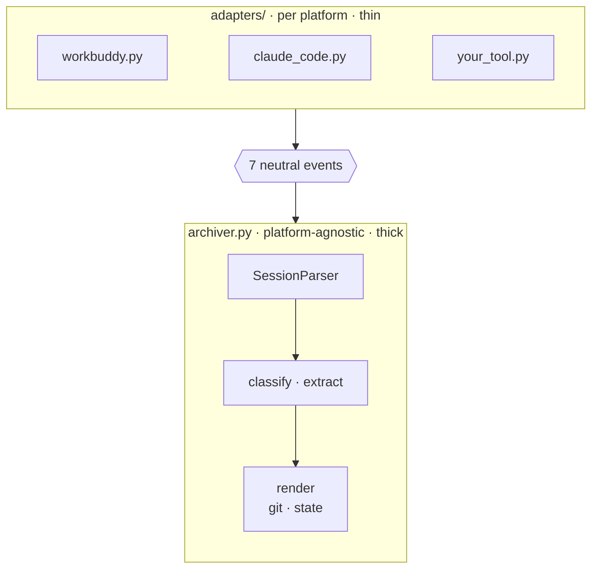

# Development notes

This file carries the implementation details deferred from the README: architecture, design constraints, per-command semantics, and the repository layout. Start with [README.en.md](README.en.md) for what the tool does and how to get going.

---

## 🧩 Architecture: a thin adapter layer, a thick platform-agnostic core

Every platform difference lives in `adapters/`; the main program never sees another vendor's JSON:



There is exactly one contract between adapters and the core — **7 neutral events**:

```text
ts / title / prompt / assistant / tool / write / tool_result
```

Adding a platform = one file in `adapters/` plus one `register()` call. The main program **does not change**. See "Adding another tool" below.

---

## 📐 Six design constraints

This is not a throwaway archiving script — every rule below was written after hitting a real problem:

| Constraint | How it is done | What it buys |
|---|---|---|
| Source only | Build output, dependencies, logs, screenshots, test samples and throwaway scripts are all excluded, each logged in `manifest.json` | A project drops from MBs to tens of KB ~ a few MB |
| Directory must stand alone | One independent git repo plus `.gitignore` per project | Zip and send it; `git clone` continues the work |
| Exclusions must be traceable | `manifest.json` records every exclusion and external dependency, plus `_evidence/` | When a file seems missing, check instead of guess |
| Rendering must be idempotent | Generation is pure-function style; two consecutive runs produce 0 changes | Safe to run on a nightly schedule |
| Incremental must be cheap | Three-level fingerprints (workspace / file / content sha1) | No repeated parsing or model calls in steady state |
| Must work without a model | Missing summary falls back to the `derive_from_manifest` template | A complete archive with zero API keys |

---

## 📦 What the output looks like

```
<archive>/
├── INDEX.md          # Master index: project / first dev / last dev / last update / type / language / sessions / files / purpose
├── index.json        # Machine-readable manifest
├── CHANGELOG.md      # Per-run change log (added / updated / lost / soft-deleted)
├── overrides.json    # Manual corrections: title / background / purpose, keep_scripts for false positives
├── state.json        # Fingerprint store — the basis for incremental sync
├── _trash/           # Directories no longer archived (soft delete, recoverable)
├── _restore/         # Historical snapshots produced by `restore` (archive untouched)
└── 2026-03-15_批量重命名工具/
    ├── README.md          # Background / features / implementation / source / sessions / overview
    ├── manifest.json      # Metadata + exclusion log + external dependency list
    ├── .gitignore  .git/  # Standalone repo, init + commit on first archive
    ├── open-session.bat  # Double-click to jump back to the latest session
    ├── source/            # Clean source, original relative paths preserved
    ├── _docs/             # Design documents (docx/pdf etc.)
    ├── _evidence/evidence.md
    ├── _meta/
    │   ├── conversations.md  # Every user instruction in this project, in order
    │   ├── integrity.md      # Project integrity check
    │   ├── sessions.json
    │   └── memory/           # Workspace project memory
    └── _summary.json      # Summary result (absent → template fallback)
```

**Directories are deliberately small**: only source, project files, config and necessary small assets. Every exclusion is logged for traceability; a typical project is tens of KB to a few MB.

---

## 🔌 Adding another tool

Each file under `scripts/adapters/` maps to one platform. Implement an `Adapter` subclass and call `register()` at the end of `__init__.py`:

```python
class MyAdapter(Adapter):
    name = "my-tool"           # also the value for --source
    display = "My Tool"
    def probe(self) -> bool: ...               # does this platform have data here?
    def load_index(self): ...                  # returns Index: ids() / info(sid) / transcript(sid)
    def iter_events(self, path, cwd=""): ...   # yields the 7 neutral events
```

The event contract and ready-made helpers live at the top of `scripts/adapters/base.py`. Two hard rules: `created` / `updated` in `info()` must be **epoch milliseconds** (otherwise cross-platform sorting breaks), and tool paths must go through `rel_in_cwd()`. After editing, run `python scripts/tests/test_adapters.py`.

---

## ⏪ Going back to a given day: `restore`

An archive is worth more than "one more look" — it is worth **being able to rewind**. Every project
directory is its own git repo with one commit per scan, so "what did the archive look like on 14 Nov"
is a question with an exact answer:

```bash
python .../archiver.py restore                            # 1. which days can I go back to
python .../archiver.py restore --date 2026-11-14          # 2. preview, zero writes
python .../archiver.py restore --date 2026-11-14 --write  # 3. expand a copy for real
```

### Three semantics — read these before the flags

| It is | It is not |
|---|---|
| Taken **only from each archive repo's own git history** | Not taken from the original workspace — which may be long deleted, renamed or overwritten |
| "What the archive looked like **at the end of that day**" | **Not "what changed that day"** — for that use `log` / `stats` |
| Only files that were **already archived at the time** | Not a backup. Media, oversized binaries, sensitive paths, `.gitignore`-excluded build output, and anything **before the first archive** were never in git and cannot be conjured back |

Two boundaries follow, and both are reported explicitly rather than silently skipped:

- **No scan ran that day** → there is no snapshot for it; `restore` falls back to the **most recent earlier commit** and prints that commit's real timestamp, never pretending it was that day
- **A project was first archived after the target date** → it is listed under "cannot restore" with the reason: `no archive before that date (first archived 2026-11-16)`

### It never overwrites the archive

The classic way to get "go back to a day" wrong is to overwrite the current archive in place, so this is
a hard constraint: `restore` only **reads** the archive repos (`git archive`, never touching the working
tree or the index) and writes into a fresh directory.

| Flag | Behaviour |
|---|---|
| default (no `--write`) | Preview only: which commit each project resolves to, file count, size — **zero writes** |
| `--write` | Expand into `<target>/_restore/<date>/<project>/`; the archive is byte-for-byte unchanged |
| `--out DIR` | Write the copy somewhere else |
| `--only KEYWORD` | Restore only matching projects |
| `--force` | Overwrite an existing copy for the same day; confirm a total above 800 MB |
| `--json` | Machine-readable (`commit` / `snapshot_at` / `files` / `bytes` per project) |

Each expanded copy carries `_restore.md` + `_restore.json` recording **which commit** every project came
from, so the result can be audited later. The copy has no `.git` — open it or build it directly.

> Need to rewind **one** project in place? You don't need this command: the archive directory is already
> a repo — `cd` into the project, pick a commit in `git log` and `git checkout <sha> -- .`.
> `restore` is for the other job: getting a copy you can open and build without touching today's archive.

---

## 🔁 Backing up to your own repos: `sync`

Commits stay **on this machine only**. If the disk dies, the ledger dies with the source. `sync` closes that gap:
it pushes to remotes **you configured yourself**.

```bash
python .../archiver.py sync              # inspect: which repos have a remote, pending changes, unpushed commits
python .../archiver.py sync --push       # commit pending changes, then push
python .../archiver.py sync --only KEYWORD  # limit to matching repos
python .../archiver.py sync --json       # machine-readable, for scheduled scripts
```

Three constraints (better to do less than to overstep):

| Constraint | Why |
|---|---|
| Only repos **with a remote** are pushed | The archiver does not decide where your backup lives, and never guesses a URL. No remote = skip, with instructions — it will not create one for you |
| **Never force** | If the remote has commits you lack, it reports and stops. The archive holds source code; one force push can erase someone else's work |
| No invented messages | A manual sync has no new prompts to draw from, so it says `sync: 手动同步（N 项变化）` |

**Why `run` doesn't push**: the nightly job should not depend on the network. A dropped connection or expired
credential would turn a successful archive run into a failing scheduled task.

Set a remote once per repo; `sync --push` picks it up from then on:

```bash
cd <archive>/<some project>
git remote add origin <your-remote-url>
```

The first push uses `git push -u`, so the upstream branch is created for you.

---

## 📤 Handing a project over

Every project in the archive is an **independent git repository** — just zip it or push it:

```bash
cd <archive>/2026-03-15_批量重命名工具
git remote add origin <your-remote-url>
git push -u origin master
```

Whoever clones it can pick up where you left off using the "Implementation" section of `README.md` and the integrity report in `_meta/integrity.md`.

---

## 📁 Repository layout

```text
dev-project-archivist/
├── SKILL.md                        # Skill entry: trigger conditions and execution rules
├── README.md  README.en.md         # Chinese / English docs
├── CHANGELOG.md                    # Release history and versioning rule
├── pyproject.toml                  # Installable via pipx / uvx (still zero dependencies)
├── .github/workflows/ci.yml        # 2 OS x 3 Python versions, full unittest discover
├── scripts/
│   ├── archiver.py                 # Core: archive / log / find / stats / report / restore
│   ├── adapters/
│   │   ├── base.py                 # Neutral event contract, Adapter base, multi-source index
│   │   ├── workbuddy.py            # WorkBuddy session index and parser
│   │   ├── claude_code.py          # Claude Code JSONL parser
│   │   └── __init__.py             # Registry and --source selection
│   └── tests/                      # 228 tests, all runnable offline
│       ├── test_adapters.py        # Adapter unit tests
│       ├── test_daylog.py          # Per-day aggregation (nothing lost or double counted)
│       ├── test_naming.py          # Name evidence chain and title cleanup
│       ├── test_find.py            # Search scoring and per-kind saturation
│       ├── test_commit_msg.py      # Commit message generation
│       ├── test_stats.py           # Cross-day ledger, same numbers as daylog
│       ├── test_report.py          # HTML report structure and redaction
│       ├── test_restore.py         # Restore semantics (throwaway git repos)
│       ├── test_sync.py            # Push safety: never force, no remote = untouched
│       ├── test_release.py         # Version triple, and README samples vs code
│       └── test_public_content.py  # Leak guard: competitor name / home paths with a username
├── references/
│   ├── automation-prompt.md        # Copy-pasteable prompt for the nightly job
│   └── data-sources.md             # Local data source structures (troubleshooting)
├── docs/                           # Process notes: assessment / plan / change log
└── LICENSE                         # AGPL-3.0
```

---

