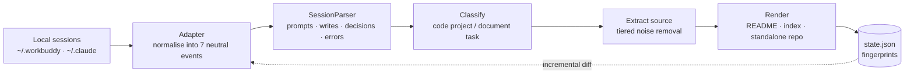
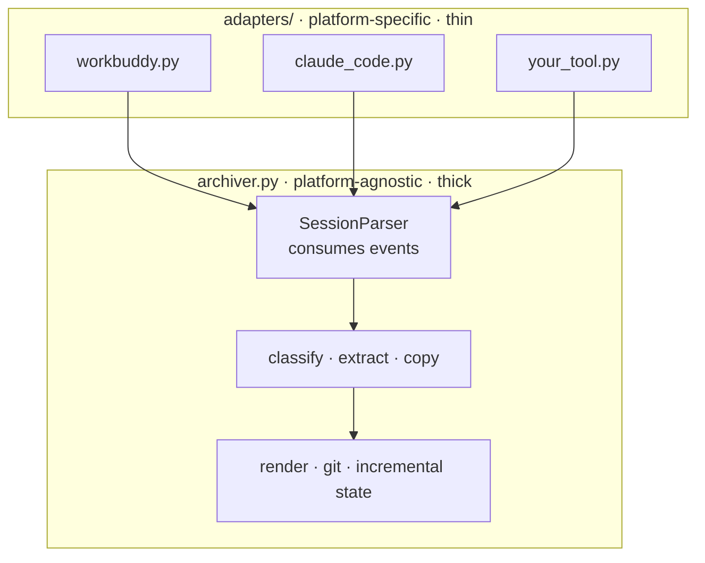

# 🗂️ Conversation Project Archivist · Turn AI chat software into a source archive you can keep building

[English](README.en.md) · [简体中文](README.md)

**Read local sessions → identify projects → archive clean source → jump back to the conversation.**

> Software built through chat becomes unfindable within three months. This tool goes and gets it back.

<p align="center">
  <a href="./LICENSE"></a>
  
  
  
  
</p>

<p align="center">
  <a href="https://github.com/winrich/dev-project-archivist" target="_blank">
    
  </a>
  <a href="https://github.com/winrich/dev-project-archivist/commits/main" target="_blank">
    
  </a>
  
</p>

<table align="center">
  <tr>
    <td align="center"><b>📦 27 projects</b><br/><sub>archived on one real machine</sub></td>
    <td align="center"><b>📉 91 → 49 MB</b><br/><sub>after keeping source only</sub></td>
    <td align="center"><b>⚡ 0 dependencies</b><br/><sub>pure Python standard library</sub></td>
    <td align="center"><b>🔗 Back to the chat</b><br/><sub>pick up where you left off</sub></td>
  </tr>
</table>

> ⭐ **If this tool recovered a few projects you thought you had lost, a star is appreciated.**

---

## 🤔 Does this sound familiar

AI made writing software easy, but **the output is scattered across conversations**, which created a new set of problems:

- 😫 A small tool you built six months ago — you cannot even find which window holds the source
- 😫 Projects spread over dozens of sessions; copying them by hand never ends
- 😫 You want to change something, but cannot recall why it was designed this way
- 😫 A full backup would work, except `node_modules`, screenshots and build output are 90% of it
- 😫 You finally collected the source, then it breaks on another machine or in someone else's hands
- 😫 The archive keeps growing and a fresh `git clone` takes minutes

**This tool turns that into a pipeline**: scan sessions → classify projects → extract source → render docs → sync incrementally. Open `INDEX.md` when it finishes, and every project is a repository you can `git clone` and keep developing.

---

## 🗺️ How it differs from the alternatives

| Approach | What you get | What it costs |
|---|---|---|
| Copy and paste by hand | Only the projects you remember | Slow, and whatever you missed stays lost |
| Back up whole directories | Source plus dependencies, screenshots, build output | Tens of GB, uncloneable, untransferable |
| Feed every session to an LLM | A nicely written description | No source code, high cost, privacy gamble |
| **This tool** | Clean source + background + per-module features + implementation notes + links back to the chat | One command, zero dependencies |

---

## 🎯 First, decide: do you need this tool, or a specific project?

| Your goal | What to do |
|---|---|
| I use AI coding agents too, and want to collect **my own** conversation projects | Install this tool (keep reading) |
| I just want to take over someone's finished project and keep developing it | **Do not install.** Take that project folder (with `source/`, `.git/`, `README.md`) and `git clone` or unzip it |
| I want to hand one of my own projects to someone else | See "Handing a project over" below |

This tool contains no project data. It only turns **local sessions** into a source archive. Other people's sessions live on their machines; installing it here finds nothing.

---

## 🧠 Understand it in 30 seconds

```bash
# 1. Inspect the classification — writes nothing
python ~/.workbuddy/skills/dev-project-archivist/scripts/archiver.py scan --dry-run

# 2. Archive for real
python ~/.workbuddy/skills/dev-project-archivist/scripts/archiver.py run
```

The first command only prints a table: how many project units were found, which are code projects, which are pure document tasks. **Run it first** and confirm the classification before anything is written.

The second, `run` = collect + render. When it finishes, open `INDEX.md` in the archive. Output defaults to `~/Workbuddy项目归档`; change it in one of two ways:

```bash
# Per command
python .../archiver.py run --target "D:\my-archive"

# Or an environment variable (Windows: set once, no flags afterwards)
[Environment]::SetEnvironmentVariable("ARCHIVER_TARGET", "D:\my-archive", "User")
```

---

## 🏗️ Pipeline



The one-liner:

```text
archive = read sessions + classify + drop noise + extract source + write docs + init repos + fingerprint
```

The real work is **deterministic parsing**. The model only handles the last step — turning a file listing and requirement history into readable prose. That division buys three things: reproducible output, no network dependency, and predictable cost.

---

## 🧩 Architecture: a thin adapter layer, a thick platform-agnostic core

Every platform difference lives in `adapters/`; the main program never sees another vendor's JSON:



There is exactly one contract between adapters and the core — **7 neutral events**:

```text
ts / title / prompt / assistant / tool / write / tool_result
```

Adding a platform = one file in `adapters/` plus one `register()` call. The main program **does not change**. See "Adding another tool" below.

---

## 📐 Six design constraints

This is not a throwaway archiving script — every rule below was written after hitting a real problem:

| Constraint | How it is done | What it buys |
|---|---|---|
| Source only | Build output, dependencies, logs, screenshots, test samples and throwaway scripts are all excluded, each logged in `manifest.json` | A project drops from MBs to tens of KB ~ a few MB |
| Directory must stand alone | One independent git repo plus `.gitignore` per project | Zip and send it; `git clone` continues the work |
| Exclusions must be traceable | `manifest.json` records every exclusion and external dependency, plus `_evidence/` | When a file seems missing, check instead of guess |
| Rendering must be idempotent | Generation is pure-function style; two consecutive runs produce 0 changes | Safe to run on a nightly schedule |
| Incremental must be cheap | Three-level fingerprints (workspace / file / content sha1) | No repeated parsing or model calls in steady state |
| Must work without a model | Missing summary falls back to the `derive_from_manifest` template | A complete archive with zero API keys |

---

## 📦 What the output looks like

```
<archive>/
├── INDEX.md          # Master index: project / first dev / last dev / last update / type / language / sessions / files / purpose
├── index.json        # Machine-readable manifest
├── CHANGELOG.md      # Per-run change log (added / updated / lost / soft-deleted)
├── overrides.json    # Manual corrections: title / background / purpose, keep_scripts for false positives
├── state.json        # Fingerprint store — the basis for incremental sync
├── _trash/           # Directories no longer archived (soft delete, recoverable)
└── 2026-03-15_批量重命名工具/
    ├── README.md          # Background / features / implementation / source / sessions / overview
    ├── manifest.json      # Metadata + exclusion log + external dependency list
    ├── .gitignore  .git/  # Standalone repo, init + commit on first archive
    ├── 打开原对话.bat      # Double-click to jump back to the latest session
    ├── source/            # Clean source, original relative paths preserved
    ├── _docs/             # Design documents (docx/pdf etc.)
    ├── _evidence/evidence.md
    ├── _meta/
    │   ├── conversations.md  # Every user instruction in this project, in order
    │   ├── integrity.md      # Project integrity check
    │   ├── sessions.json
    │   └── memory/           # Workspace project memory
    └── _summary.json      # Summary result (absent → template fallback)
```

**Directories are deliberately small**: only source, project files, config and necessary small assets. Every exclusion is logged for traceability; a typical project is tens of KB to a few MB.

---

## 🤖 Supported AI tools

| Tool | Session data | Status |
|---|---|---|
| WorkBuddy | `~/.workbuddy/` | ✅ Works out of the box, includes `workbuddy://` deep links |
| Claude Code | `~/.claude/projects/` | ✅ Works out of the box, degrades to a `claude --resume` hint when no deep link exists |
| Other local agents | Needs its own adapter | See "Adding another tool" |

Use `--source` to pick the source. The default `all` auto-detects what is installed; you can also pass `workbuddy`, `claude-code`, or a comma-separated combination. A tool with no local data is skipped silently instead of failing.

**Why web-based ChatGPT / Claude is not supported**: those services keep conversations in the cloud, so the code never lands on your disk as files. The archivist cannot obtain its single most important deliverable — the complete source. This tool targets **agent-style tools that write files locally**.

### 🔌 Adding another tool

Each file under `scripts/adapters/` maps to one platform. Implement an `Adapter` subclass and call `register()` at the end of `__init__.py`:

```python
class MyAdapter(Adapter):
    name = "my-tool"           # also the value for --source
    display = "My Tool"
    def probe(self) -> bool: ...               # does this platform have data here?
    def load_index(self): ...                  # returns Index: ids() / info(sid) / transcript(sid)
    def iter_events(self, path, cwd=""): ...   # yields the 7 neutral events
```

The event contract and ready-made helpers live at the top of `scripts/adapters/base.py`. Two hard rules: `created` / `updated` in `info()` must be **epoch milliseconds** (otherwise cross-platform sorting breaks), and tool paths must go through `rel_in_cwd()`. After editing, run `python scripts/tests/test_adapters.py`.

---

## 🚀 Quick start

### 0. Requirements

| Item | Requirement |
|---|---|
| OS | Windows / macOS / Linux |
| Python | 3.8+ (**no pip install needed**, standard library only) |
| AI tool | Local session data from at least one supported tool, see above |
| git | Optional. Needed to give each project its own repository; without it that step is skipped and everything else still works |

### 1. Install

**Option 1: git clone (recommended, easy to update later)**

```bash
# WorkBuddy
git clone https://github.com/winrich/dev-project-archivist.git ~/.workbuddy/skills/dev-project-archivist

# Claude Code
git clone https://github.com/winrich/dev-project-archivist.git ~/.claude/skills/dev-project-archivist
```

**Option 2: zip archive**

Unzip and place the whole `dev-project-archivist` folder into the skills directory of the target tool, so the final path is:

```
~/.workbuddy/skills/dev-project-archivist/SKILL.md     # WorkBuddy
~/.claude/skills/dev-project-archivist/SKILL.md        # Claude Code
```

**Restart the tool** after installing for it to appear in the skill list. You can also skip the skill entirely and run the CLI — the archiving logic does not depend on any host tool.

### 2. Run it

```bash
python ~/.workbuddy/skills/dev-project-archivist/scripts/archiver.py scan --dry-run   # classification only
python ~/.workbuddy/skills/dev-project-archivist/scripts/archiver.py run              # archive for real
```

> Commands assume the WorkBuddy install path. If installed under Claude Code, replace `~/.workbuddy/skills/` with `~/.claude/skills/`.

### 3. Use it in a conversation

After restarting, simply tell the assistant:

> Archive the projects I built across my conversations.

The skill is picked up automatically and runs the same pipeline.

---

## 🆓 Zero-cost mode (no LLM required)

**LLM summarisation is optional.** Skip it and the archive is still complete — project names fall back to folder names, and feature notes are derived from the file listing:

```bash
python .../archiver.py run
```

`run` does not include summarisation; rendering automatically uses the **template fallback** (`derive_from_manifest`). It suits three cases: you do not want an API key or any token cost; you just want the source collected now and the prose later; a one-off run on someone else's machine.

**Upgrading to LLM summaries later is easy**: write `_summary.json` for a project and re-run `render` — no re-scan needed. Conversely, delete `_summary.json` and re-render to fall back to the template.

> There is no `--no-llm` switch. Whether a model is called depends purely on whether you ran the summarisation step.

**When is a model worth it**: when you have many projects and want readable names plus coherent feature descriptions. A nightly job only summarises projects that changed, so in steady state the model call count is 0.

---

## 🔗 Going back to the original conversation

The jump mechanism depends on the session's source; tools without deep-link support never get a broken link forced onto them.

| Platform | How to open |
|---|---|
| WorkBuddy | Click "打开对话" in the README, or double-click `打开原对话.bat` in the project root |
| Claude Code | `打开原对话.md` in the project root records the session ID and a `claude --resume <ID>` command |

Regardless of platform, every project has `_meta/conversations.md` — all user instructions for that project in chronological order, so you can see the requirement evolution without jumping anywhere.

---

## 📚 Command reference

| Command | What it does |
|---|---|
| `scan` | Collect / extract / copy source, write the evidence pack and the pending-summarisation list |
| `scan --dry-run` | Print the classification table only, zero writes (**use first to calibrate**) |
| `scan --force` | Ignore fingerprints and rescan (after switching machines or changing rules) |
| `scan --only KEYWORD` | Only process projects matching the keyword in name / path / session title / archive dir |
| `scan --limit N` | Only process the N most recent projects |
| `render` | Generate READMEs and the master index from summaries (idempotent) |
| `run` | scan + render |
| `--source all\|workbuddy\|claude-code` | Choose data source(s). Default `all` auto-detects; comma-separated allowed |
| `pending` | List projects whose evidence changed and need re-summarising |
| `status` | Last run time, lost projects, projects missing summaries |
| `git-clean` | Rebuild the repositories this tool created, purging large objects from history |

---

## 🌙 Daily automation (optional)

Create a scheduled task in your AI tool (WorkBuddy automation, system scheduler — any works) with a three-step prompt: `scan` → read `pending` and summarise each → `render`. A complete copy-pasteable prompt is in [`references/automation-prompt.md`](references/automation-prompt.md).

Key points:

- Only projects whose **fingerprint changed** enter `pending`, so the model call count is 0 on stable days
- Schedule it off-peak and bind it to a cheaper model
- **Always pass `--target` explicitly in scheduled jobs** — do not rely on the environment variable

---

## ❓ FAQ

**Nothing is found**
Confirm that `.jsonl` transcripts exist under `~/.workbuddy/projects/` (or `~/.claude/projects/`). A fresh install with no prior conversations has nothing to archive.

**Classification is wrong — a chat got treated as a project**
Run `scan --dry-run` first and look at the table. The rule is "source files ≥ 5 and at least 30% of the document count". Tune with `--min-code N`; to permanently exclude a workspace, set `skip: true` for it in `overrides.json`.

**Wrong project name or description**
Override `title` / `background` / `purpose` in `overrides.json` by workspace path or archive directory name, then re-run `render`.

**A core script was excluded by mistake**
The tool drops one-off scripts shaped like `repro_*`, `check_*`, `*_bak`. If it hits a real file, add `{"keep_scripts": ["name.py"]}` to `overrides.json` and re-run `scan --force`.

**A project keeps saying "no changes" although it did change**
`scan --force --only KEYWORD`.

**The index shows ⚠️ lost**
The original workspace was deleted; the archive and its source copy are still intact.

**The project directory is larger than expected**
Check `excluded.external` in `manifest.json` and the large files under `source/`. Defaults: 5 MB per file, 40 MB of source per project, 256 KB resource threshold — anything above is logged rather than copied.

**The git repository is suspiciously large**
After changing exclusion rules, old large blobs may remain in history: `python .../archiver.py git-clean`.

---

## 📤 Handing a project over

Every project in the archive is an **independent git repository** — just zip it or push it:

```bash
cd <archive>/2026-03-15_批量重命名工具
git remote add origin <your-remote-url>
git push -u origin master
```

Whoever clones it can pick up where you left off using the "Implementation" section of `README.md` and the integrity report in `_meta/integrity.md`.

---

## 📁 Repository layout

```text
dev-project-archivist/
├── SKILL.md                        # Skill entry: trigger conditions and execution rules
├── README.md  README.en.md         # Chinese / English docs
├── scripts/
│   ├── archiver.py                 # Pipeline core (~2300 lines, standard library only)
│   ├── adapters/
│   │   ├── base.py                 # Neutral event contract, Adapter base, multi-source index
│   │   ├── workbuddy.py            # WorkBuddy session index and parser
│   │   ├── claude_code.py          # Claude Code JSONL parser
│   │   └── __init__.py             # Registry and --source selection
│   └── tests/
│       └── test_adapters.py        # Adapter unit tests
├── references/
│   ├── automation-prompt.md        # Copy-pasteable prompt for the nightly job
│   └── data-sources.md             # Local data source structures (troubleshooting)
└── LICENSE                         # MIT
```

---

## 🤝 Contributing

Issues and PRs are welcome. Especially useful:

- Adapters for other AI tools (Codex CLI / Cline / Roo Code / Cursor)
- Fixes for file rules that wrongly exclude or include something
- Readability improvements to the rendered READMEs
- Wording fixes in the English docs

Before submitting, please run:

```bash
python scripts/tests/test_adapters.py
python scripts/archiver.py scan --dry-run
```

---

## 📄 License

[MIT](LICENSE)

---

<p align="center">
  ⭐ <b>If this project helped you, a star is appreciated.</b> ⭐
</p>
