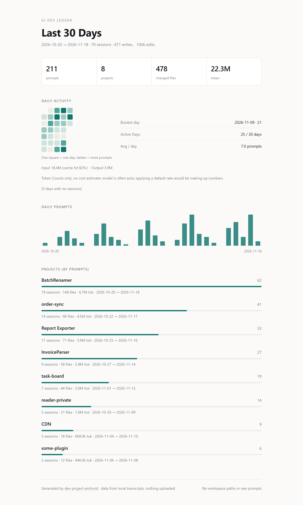
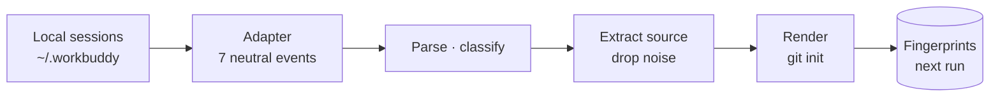
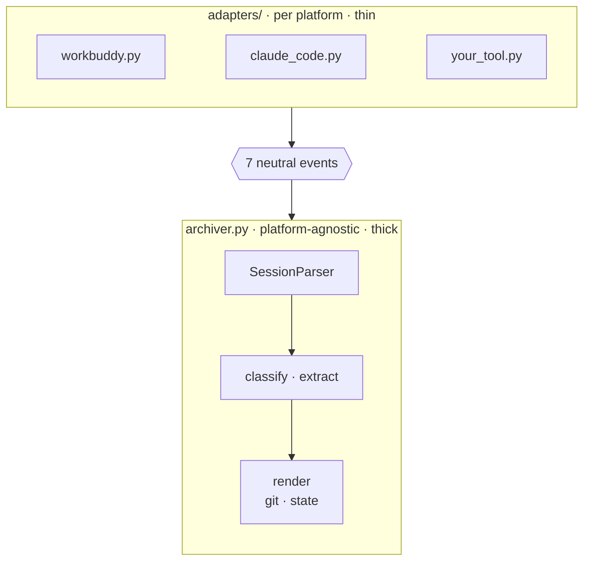

# 🗂️ Conversation Project Archivist · Turn AI chat software into a source archive you can keep building

[English](README.en.md) · [简体中文](README.md)

**Read local sessions → identify projects → archive clean source → jump back to the conversation.**

> Software built through chat becomes unfindable within three months. This tool goes and gets it back.

<p align="center">
  <a href="https://github.com/winrich/dev-project-archivist/releases"></a>
  <a href="./LICENSE"></a>
  
  
  
  
</p>

<p align="center">
  <a href="https://github.com/winrich/dev-project-archivist" target="_blank">
    
  </a>
  <a href="https://github.com/winrich/dev-project-archivist/commits/main" target="_blank">
    
  </a>
  
</p>

<table align="center">
  <tr>
    <td align="center"><b>📦 27 projects</b><br/><sub>archived on one real machine</sub></td>
    <td align="center"><b>📉 91 → 49 MB</b><br/><sub>after keeping source only</sub></td>
    <td align="center"><b>⚡ 0 dependencies</b><br/><sub>pure Python standard library</sub></td>
    <td align="center"><b>🔗 Back to the chat</b><br/><sub>pick up where you left off</sub></td>
  </tr>
</table>

> ⭐ **If this tool recovered a few projects you thought you had lost, a star is appreciated.**

---

## 🤔 Does this sound familiar

AI made writing software easy, but **the output is scattered across conversations**, which created a new set of problems:

- 😫 A small tool you built six months ago — you cannot even find which window holds the source
- 😫 Projects spread over dozens of sessions; copying them by hand never ends
- 😫 You want to change something, but cannot recall why it was designed this way
- 😫 A full backup would work, except `node_modules`, screenshots and build output are 90% of it
- 😫 You finally collected the source, then it breaks on another machine or in someone else's hands
- 😫 The archive keeps growing and a fresh `git clone` takes minutes

**This tool turns that into a pipeline**: scan sessions → classify projects → extract source → render docs → sync incrementally. Open `INDEX.md` when it finishes, and every project is a repository you can `git clone` and keep developing.

---

## 🗺️ How it differs from the alternatives

| Approach | What you get | What it costs |
|---|---|---|
| Copy and paste by hand | Only the projects you remember | Slow, and whatever you missed stays lost |
| Back up whole directories | Source plus dependencies, screenshots, build output | Tens of GB, uncloneable, untransferable |
| Feed every session to an LLM | A nicely written description | No source code, high cost, privacy gamble |
| **This tool** | Clean source + background + per-module features + implementation notes + links back to the chat | One command, zero dependencies |

---

## 🎯 First, decide: do you need this tool, or a specific project?

| Your goal | What to do |
|---|---|
| I use AI coding agents too, and want to collect **my own** conversation projects | Install this tool (keep reading) |
| I just want to take over someone's finished project and keep developing it | **Do not install.** Take that project folder (with `source/`, `.git/`, `README.md`) and `git clone` or unzip it |
| I want to hand one of my own projects to someone else | See "Handing a project over" below |

This tool contains no project data. It only turns **local sessions** into a source archive. Other people's sessions live on their machines; installing it here finds nothing.

---

## 🧠 Understand it in 30 seconds

Commands come in three groups — don't mix up their frequency:
**`scan` / `run` run a few times a month; `find` / `stats` / `report` / `restore` are daily; `sync` when you think of it.**

Every command below is followed by what it actually prints. `…` marks elided lines; numbers are invented; the columns
are padded by the real print code. (CLI messages are in Chinese for now.)

### First time: check the classification, then write

**1. Classify only — writes nothing**

```bash
python ~/.workbuddy/skills/dev-project-archivist/scripts/archiver.py scan --dry-run
```

```text
[1/3] 会话索引：214 个会话，198 份转录
[2/3] 归并完成：8 个项目单元

日期        类型      语言              码   档  文件  项目
---------------------------------------------------------------------------------------------------
2026-10-20  代码项目  C#               298   14   312  BatchRenamer batch-renamer
2026-10-22  代码项目  Python            88    8    96  order-sync order-sync
2026-10-25  代码项目  Python            61    10    71  报表导出器 report-export
2026-10-27  混合产物  Python            44    14    58  InvoiceParser invoice-parser
2026-11-04  代码项目  TypeScript        15    3    18  CDN cdn-tools
2026-11-06  文档任务  —                  0   12    12  some-plugin some-plugin
…
---------------------------------------------------------------------------------------------------
小计：代码项目 5 / 文档任务 2 / 混合产物 1 / 空壳 0
```

One table answers two questions: which project units were found, and what each was judged to be (`码` = source files,
`档` = documents). **Run it first** — the judgement looks at workspace paths and file layout, and a wrong call means
junk directories in your archive.

**2. Classification looks right? Archive for real**

```bash
python ~/.workbuddy/skills/dev-project-archivist/scripts/archiver.py run
```

```text
[1/3] 会话索引：214 个会话，198 份转录
[2/3] 归并完成：8 个项目单元
  [1/8] = 无变化 BatchRenamer
  [2/8] + 2026-10-22_order-sync  (源码 96 个 / 1.2 MB，文档 1 个，剔除 24)
  [3/8] + 2026-10-25_报表导出器  (源码 71 个 / 941.4 KB，文档 3 个，剔除 41)
  …
[3/3] 扫描完成：更新 4 / 跳过 4 / 待归纳 2，耗时 12.4s
[render] README 更新 4 个，索引项目 8 个
```

`run` = collect + render. `= 无变化` means the fingerprint layer skipped it (nothing changed, so nothing was
re-parsed); `+` means it was written this run, followed by copied files, size and exclusions. When it finishes, open
`INDEX.md` in the archive — every project is in there.

Output defaults to `~/Workbuddy项目归档`; change it in one of two ways:

```bash
# Per command
python .../archiver.py run --target "D:\my-archive"

# Or an environment variable (Windows: set once, no flags afterwards)
[Environment]::SetEnvironmentVariable("ARCHIVER_TARGET", "D:\my-archive", "User")
```

### Then, every day: four read-only commands

**Find things**

```bash
python ~/.workbuddy/skills/dev-project-archivist/scripts/archiver.py find "批处理 PowerShell"
```

```text
3 条命中 · 用时 0.21s

InvoiceParser  ·  2026-11-12 → 2026-11-15  ·  评分 24
  工作区  D:/code/InvoiceParser
  [指令] 2026-11-12 21:04  写个批处理把 build.bat 转成 ps1，顺便带上参数
  [文件] source/tools/convert.ps1

  → 直接回场：archiver.py find "批处理 PowerShell" --open
```

Project names, file names and prompt text are searched together; with multiple words, **all must match**. `--open`
jumps straight back into the top hit's original conversation. Read-only: no lock, no files written.

**How much did this week cost you**

```bash
python ~/.workbuddy/skills/dev-project-archivist/scripts/archiver.py stats --days 7
```

```text
  最近 7 天 · 2026-11-12 → 2026-11-18

  对话 60 · 会话 19 · 项目 5 · 改动文件 143（写 96 / 改 47）
  Token 输入 4.2M（缓存命中 82%）· 输出 900.0k · 合计 5.1M
  成本：不估算（模型归属常为 auto，拿默认单价顶替等于编数字）

  每日对话  ▂▁▅▆▃█▂

  日期         对话   项目   文件    token
  ----------------------------------------
  11-12           2      1      5   210.0k
  11-13           0      0      0        0
  11-14          12      3     28     1.0M
  11-15          16      3     38     1.4M
  11-16           6      2     14   510.0k
  11-17          21      4     50     1.7M
  11-18           3      1      8   260.0k

  最活跃项目
      21 对话 ·  50 文件 ·    1.7M tok   BatchRenamer
      18 对话 ·  41 文件 ·    1.5M tok   order-sync
      11 对话 ·  33 文件 ·  940.0k tok   报表导出器

  空白天    11-13（没有会话）
```

No `scan` required first — it reads transcripts already on disk, so day one has numbers. The cost line always reads
"not estimated": the model field is often `auto`, and multiplying by a default price would be inventing data.

**Something to show a colleague**

```bash
python ~/.workbuddy/skills/dev-project-archivist/scripts/archiver.py report --days 30 --open
```

```text
已写入 C:/Users/me/Workbuddy项目归档/report/report-2026-10-20_2026-11-18.html
  30 天 · 8 个项目 · 211 条对话 · 22.3M token
  报告不含工作区路径与指令原文，可直接分享
```

One self-contained HTML file: double-click and it opens — no network requests, no web fonts. What the page itself
looks like: see "👀 What it looks like" below.

**What the archive looked like last Wednesday**

```bash
python ~/.workbuddy/skills/dev-project-archivist/scripts/archiver.py restore --date 2026-11-14
```

```text
  归档快照 2026-11-14（当天 23:59:59 之前最后一次提交）
  预览，未写任何文件

  项目                          快照时间             文件      体积
  ------------------------------------------------------------------
  2026-10-20_BatchRenamer       11-14 22:41            47    1.2 MB
  2026-10-22_order-sync         11-14 19:03            38  860.0 KB
  2026-10-25_报表导出器         11-14 16:27            21  420.0 KB
  2026-10-27_InvoiceParser      11-14 11:52            13  210.0 KB
  … 另 4 个

  小计 8 个项目 · 213 个文件 · 4.6 MB

    2026-10-20_BatchRenamer      4b7d2c19  批处理转换：把 build.bat 转成 ps1 等 3 项
    2026-10-22_order-sync        c81f5a3e  订单对账：先跑通一天再谈批量 等 2 项
    2026-10-25_报表导出器             2e9a06b7  导出加一列毛利率 等 4 项
    2026-10-27_InvoiceParser     d1c4f8a2  发票号从附件名里取，取不到就留空 等 2 项
    … 另 4 个，--json 看全部

  这只是预览。加 --write 才会展开成副本（不会改动归档本身）：
    restore --date 2026-11-14 --write
```

Preview by default: a restore can be hundreds of MB, so look at "which version, how many files" before deciding.
`--write` expands into `<archive>/_restore/2026-11-14/` and touches nothing in the archive itself. Projects that
cannot be restored are listed separately with the reason (repo has no commits / nothing archived before that day).

### When you remember to: back the archive up to your own repos

```bash
python ~/.workbuddy/skills/dev-project-archivist/scripts/archiver.py sync          # preview
python ~/.workbuddy/skills/dev-project-archivist/scripts/archiver.py sync --push   # really push
```

```text
  归档仓库 8 个 · 配了远端 6 个 · 有未提交改动 3 个 · 待推送 5 个提交

  仓库                      分支     远端                           待提交  待推送
  ------------------------------------------------------------------------------
  2026-10-20_BatchRenamer   main     github.com/me/batch-renamer         2      +2
  2026-10-22_order-sync     main     github.com/me/order-sync            -       -
  2026-10-25_报表导出器     main     github.com/me/report-export         1      +2
  2026-10-27_InvoiceParser  main     github.com/me/invoice-parser        -      +1
  2026-10-29_reader-private main     github.com/me/reader-private        -       -
  2026-11-01_task-board     main     github.com/me/task-board            -       -

  2 个仓库没配远端（不会推送）。要备份到自己的仓库，在归档目录里各执行一次：
      git remote add origin <你的仓库地址>
  之后 `sync --push` 就会带上它们。

  这是预览，没有提交也没有推送。加 --push 才执行。
```

It only pushes repos **that already have a remote of their own** (no guessed URLs, no auto-created remotes), **never
forces**, and is not part of `run` (a scheduled task should not depend on the network).

---

## 👀 What it looks like

Look at the output first, decide later whether to read on. This is what the page `report` generates looks like:

<p align="center">
  
</p>

One self-contained HTML file: double-click and it opens — no network requests, no web fonts, safe to hand to someone else. Four summary cards (prompts / projects / changed files / tokens), a calendar heatmap, a daily bar chart, and projects ranked by prompt count.

**Shareable and safe-to-share are two different things**: no workspace paths and no prompt text in the page — the only external link is a few words in the footer.

> The image comes from [`docs/sample/report-demo.html`](docs/sample/report-demo.html), generated by
> [`docs/sample/build_sample.py`](docs/sample/build_sample.py) — **invented data** fed to the **same renderer**
> you run. Names and numbers are made up; the layout is exactly what you get. Change the styles and the sample
> follows, so it never drifts.

Terminal output for every command — classification table, search hits, ledger numbers, restore preview — is in
"🧠 Understand it in 30 seconds" above, right under each command.

---

## 🏗️ Pipeline



The fingerprint store keeps three-level hashes (workspace / file / content). The next run compares before parsing, which is why a steady-state run makes zero model calls.

The one-liner:

```text
archive = read sessions + classify + drop noise + extract source + write docs + init repos + fingerprint
```

The real work is **deterministic parsing**. The model only handles the last step — turning a file listing and requirement history into readable prose. That division buys three things: reproducible output, no network dependency, and predictable cost.

---

## 🧩 Architecture: a thin adapter layer, a thick platform-agnostic core

Every platform difference lives in `adapters/`; the main program never sees another vendor's JSON:



There is exactly one contract between adapters and the core — **7 neutral events**:

```text
ts / title / prompt / assistant / tool / write / tool_result
```

Adding a platform = one file in `adapters/` plus one `register()` call. The main program **does not change**. See "Adding another tool" below.

---

## 📐 Six design constraints

This is not a throwaway archiving script — every rule below was written after hitting a real problem:

| Constraint | How it is done | What it buys |
|---|---|---|
| Source only | Build output, dependencies, logs, screenshots, test samples and throwaway scripts are all excluded, each logged in `manifest.json` | A project drops from MBs to tens of KB ~ a few MB |
| Directory must stand alone | One independent git repo plus `.gitignore` per project | Zip and send it; `git clone` continues the work |
| Exclusions must be traceable | `manifest.json` records every exclusion and external dependency, plus `_evidence/` | When a file seems missing, check instead of guess |
| Rendering must be idempotent | Generation is pure-function style; two consecutive runs produce 0 changes | Safe to run on a nightly schedule |
| Incremental must be cheap | Three-level fingerprints (workspace / file / content sha1) | No repeated parsing or model calls in steady state |
| Must work without a model | Missing summary falls back to the `derive_from_manifest` template | A complete archive with zero API keys |

---

## 📦 What the output looks like

```
<archive>/
├── INDEX.md          # Master index: project / first dev / last dev / last update / type / language / sessions / files / purpose
├── index.json        # Machine-readable manifest
├── CHANGELOG.md      # Per-run change log (added / updated / lost / soft-deleted)
├── overrides.json    # Manual corrections: title / background / purpose, keep_scripts for false positives
├── state.json        # Fingerprint store — the basis for incremental sync
├── _trash/           # Directories no longer archived (soft delete, recoverable)
├── _restore/         # Historical snapshots produced by `restore` (archive untouched)
└── 2026-03-15_批量重命名工具/
    ├── README.md          # Background / features / implementation / source / sessions / overview
    ├── manifest.json      # Metadata + exclusion log + external dependency list
    ├── .gitignore  .git/  # Standalone repo, init + commit on first archive
    ├── open-session.bat  # Double-click to jump back to the latest session
    ├── source/            # Clean source, original relative paths preserved
    ├── _docs/             # Design documents (docx/pdf etc.)
    ├── _evidence/evidence.md
    ├── _meta/
    │   ├── conversations.md  # Every user instruction in this project, in order
    │   ├── integrity.md      # Project integrity check
    │   ├── sessions.json
    │   └── memory/           # Workspace project memory
    └── _summary.json      # Summary result (absent → template fallback)
```

**Directories are deliberately small**: only source, project files, config and necessary small assets. Every exclusion is logged for traceability; a typical project is tens of KB to a few MB.

---

## 🤖 Supported AI tools

| Tool | Session data | Status |
|---|---|---|
| WorkBuddy | `~/.workbuddy/` | ✅ Works out of the box, includes `workbuddy://` deep links |
| Claude Code | `~/.claude/projects/` | ✅ Works out of the box, degrades to a `claude --resume` hint when no deep link exists |
| Other local agents | Needs its own adapter | See "Adding another tool" |

Use `--source` to pick the source. The default `all` auto-detects what is installed; you can also pass `workbuddy`, `claude-code`, or a comma-separated combination. A tool with no local data is skipped silently instead of failing.

**Why web-based ChatGPT / Claude is not supported**: those services keep conversations in the cloud, so the code never lands on your disk as files. The archivist cannot obtain its single most important deliverable — the complete source. This tool targets **agent-style tools that write files locally**.

### 🔌 Adding another tool

Each file under `scripts/adapters/` maps to one platform. Implement an `Adapter` subclass and call `register()` at the end of `__init__.py`:

```python
class MyAdapter(Adapter):
    name = "my-tool"           # also the value for --source
    display = "My Tool"
    def probe(self) -> bool: ...               # does this platform have data here?
    def load_index(self): ...                  # returns Index: ids() / info(sid) / transcript(sid)
    def iter_events(self, path, cwd=""): ...   # yields the 7 neutral events
```

The event contract and ready-made helpers live at the top of `scripts/adapters/base.py`. Two hard rules: `created` / `updated` in `info()` must be **epoch milliseconds** (otherwise cross-platform sorting breaks), and tool paths must go through `rel_in_cwd()`. After editing, run `python scripts/tests/test_adapters.py`.

---

## 🚀 Quick start

### 0. Requirements

| Item | Requirement |
|---|---|
| OS | Windows / macOS / Linux |
| Python | 3.8+ (**no pip install needed**, standard library only) |
| AI tool | Local session data from at least one supported tool, see above |
| git | Optional. Needed to give each project its own repository; without it that step is skipped and everything else still works |

### 1. Install

**Option 1: git clone (recommended, easy to update later)**

```bash
# WorkBuddy
git clone https://github.com/winrich/dev-project-archivist.git ~/.workbuddy/skills/dev-project-archivist

# Claude Code
git clone https://github.com/winrich/dev-project-archivist.git ~/.claude/skills/dev-project-archivist
```

**Option 2: zip archive**

Unzip and place the whole `dev-project-archivist` folder into the skills directory of the target tool, so the final path is:

```
~/.workbuddy/skills/dev-project-archivist/SKILL.md     # WorkBuddy
~/.claude/skills/dev-project-archivist/SKILL.md        # Claude Code
```

**Restart the tool** after installing for it to appear in the skill list. You can also skip the skill entirely and run the CLI — the archiving logic does not depend on any host tool.

### 2. Run it

```bash
python ~/.workbuddy/skills/dev-project-archivist/scripts/archiver.py scan --dry-run   # classification only
python ~/.workbuddy/skills/dev-project-archivist/scripts/archiver.py run              # archive for real
```

> Commands assume the WorkBuddy install path. If installed under Claude Code, replace `~/.workbuddy/skills/` with `~/.claude/skills/`.

### 3. Use it in a conversation

After restarting, simply tell the assistant:

> Archive the projects I built across my conversations.

The skill is picked up automatically and runs the same pipeline.

---

## 🆓 Zero-cost mode (no LLM required)

**LLM summarisation is optional.** Skip it and the archive is still complete — project names fall back to folder names, and feature notes are derived from the file listing:

```bash
python .../archiver.py run
```

`run` does not include summarisation; rendering automatically uses the **template fallback** (`derive_from_manifest`). It suits three cases: you do not want an API key or any token cost; you just want the source collected now and the prose later; a one-off run on someone else's machine.

**Upgrading to LLM summaries later is easy**: write `_summary.json` for a project and re-run `render` — no re-scan needed. Conversely, delete `_summary.json` and re-render to fall back to the template.

> There is no `--no-llm` switch. Whether a model is called depends purely on whether you ran the summarisation step.

**When is a model worth it**: when you have many projects and want readable names plus coherent feature descriptions. A nightly job only summarises projects that changed, so in steady state the model call count is 0.

---

## 🔗 Going back to the original conversation

The jump mechanism depends on the session's source; tools without deep-link support never get a broken link forced onto them.

| Platform | How to open |
|---|---|
| WorkBuddy | Click "打开对话" in the README, or run `open-session.bat` in the project root (`.command` on macOS, `.sh` on Linux) |
| Claude Code | `open-session.md` in the project root records the session ID and a `claude --resume <ID>` command |

Regardless of platform, every project has `_meta/conversations.md` — all user instructions for that project in chronological order, so you can see the requirement evolution without jumping anywhere.

---

## 🛠️ Management console: maintain the watched-project list

If you would rather not edit `overrides.json` by hand, start a browser console that listens on **localhost only**:

```bash
python scripts/archiver.py manage --target "<archive dir>" --port 8765
```

- `--port` changes the port; `--port 0` asks the OS for a free one (the terminal prints the actual URL).
- On first launch a random password is generated and printed **once**; set `ARCHIVER_MANAGE_PASSWORD` beforehand to use your own. The password is stored as a PBKDF2 hash in `manage.auth.json` — never in plaintext.
- The server binds only `127.0.0.1`. Cookies are HttpOnly + SameSite=Strict, writes require a CSRF token, and five failed logins lock the client for 60 seconds.

| Action | Behaviour | Safety |
|---|---|---|
| **Rename** | Changes the display name only (`title` in `overrides.json`); **the directory name is untouched** | Manual names survive later `render` runs |
| **Rename directory** | Separate action; changes the directory only, display name unchanged | Rejects illegal characters and collisions, auto-backup, rollback on failure |
| **Unwatch** | Hides the project from the default list and `find`; **source and ledger stay intact** | Switch to "All" to see and restore it |
| **Pin** | Moves the project to the top of the index and console | Stable sort; history ledger unaffected |
| **Details** | Aggregates purpose, tech, sessions, files, original-chat links and a manual note | Read-only |
| **Delete** | Stops archiving (`skip=true`) and moves the directory into `_trash/` | Soft delete, recoverable by hand |

The console shares the same file lock as scheduled runs, and every change is recorded in `CHANGELOG.md`.

> ⚠️ Renaming a directory changes the archive path and may break old links. To fix a name, use **Rename** instead.

---

## 📚 Command reference

The seven commands you actually use, with their output, are in "🧠 Understand it in 30 seconds" above; this is the
full flag list.

| Command | What it does |
|---|---|
| `scan` | Collect / extract / copy source, write the evidence pack and the pending-summarisation list |
| `scan --dry-run` | Print the classification table only, zero writes (**use first to calibrate**) |
| `scan --dry-run --all` | Also list empty-shell sessions (collapsed by default) |
| `scan --explain [KEYWORD]` | Print why a project was classified this way and where its name came from (read-only) |
| `scan --force` | Ignore fingerprints and rescan (after switching machines or changing rules) |
| `scan --only KEYWORD` | Only process projects matching the keyword in name / path / session title / archive dir |
| `scan --limit N` | Only process the N most recent projects |
| `render` | Generate READMEs and the master index from summaries (idempotent) |
| `run` | scan + render |
| `--source all\|workbuddy\|claude-code` | Choose data source(s). Default `all` auto-detects; comma-separated allowed |
| `pending` | List projects whose evidence changed and need re-summarising |
| `status` | Last run time, lost projects, projects missing summaries, `.git` size check |
| `git-clean` | Rebuild the repositories this tool created, purging large objects from history |
| `sync` | **Inspect repo sync state**: remote / uncommitted / unpushed. Read-only |
| `sync --push` | Commit pending changes and push to each repo's own remote (no remote = skip, never force) |
| `sync --only KEYWORD` | Limit to repos whose name matches; `--json` for machine-readable output |
| `find KEYWORD` | **Cross-project search**: names / file names / prompt text. All words must match. Read-only |
| `find KEYWORD --open` | Open the original conversation of the top hit |
| `find KEYWORD --json` | Machine-readable output (score + snippets) |
| `manage --port 8765` | Start the local browser console; `--port 0` picks a free port, binds 127.0.0.1 only |
| `stats --days 7` | **Cross-day ledger**: prompts / projects / files / tokens for the last N days, plus a daily bar (read-only; `--date` sets the end date, `--json` for scripts) |
| `report --days 30` | **Write a single-file HTML ledger**: heatmap + bar chart + project cards. No paths, no prompt text — safe to share (`--out` dir, `--open` to launch) |
| `restore` | List **which days you can go back to** (days on which the archive repos have commits) |
| `restore --date 2026-11-14` | **Preview** the snapshot as of that day's end: projects / files / size, zero writes |
| `restore --date 2026-11-14 --write` | Expand a copy into `<target>/_restore/2026-11-14/` — **never overwrites the archive** |
| `restore --date 2026-11-14 --write --only KEYWORD` | Restore only matching projects |
| `restore --date 2026-11-14 --json` | Machine-readable output |

---

## ⏪ Going back to a given day: `restore`

An archive is worth more than "one more look" — it is worth **being able to rewind**. Every project
directory is its own git repo with one commit per scan, so "what did the archive look like on 14 Nov"
is a question with an exact answer:

```bash
python .../archiver.py restore                            # 1. which days can I go back to
python .../archiver.py restore --date 2026-11-14          # 2. preview, zero writes
python .../archiver.py restore --date 2026-11-14 --write  # 3. expand a copy for real
```

### Three semantics — read these before the flags

| It is | It is not |
|---|---|
| Taken **only from each archive repo's own git history** | Not taken from the original workspace — which may be long deleted, renamed or overwritten |
| "What the archive looked like **at the end of that day**" | **Not "what changed that day"** — for that use `log` / `stats` |
| Only files that were **already archived at the time** | Not a backup. Media, oversized binaries, sensitive paths, `.gitignore`-excluded build output, and anything **before the first archive** were never in git and cannot be conjured back |

Two boundaries follow, and both are reported explicitly rather than silently skipped:

- **No scan ran that day** → there is no snapshot for it; `restore` falls back to the **most recent earlier commit** and prints that commit's real timestamp, never pretending it was that day
- **A project was first archived after the target date** → it is listed under "cannot restore" with the reason: `no archive before that date (first archived 2026-11-16)`

### It never overwrites the archive

The classic way to get "go back to a day" wrong is to overwrite the current archive in place, so this is
a hard constraint: `restore` only **reads** the archive repos (`git archive`, never touching the working
tree or the index) and writes into a fresh directory.

| Flag | Behaviour |
|---|---|
| default (no `--write`) | Preview only: which commit each project resolves to, file count, size — **zero writes** |
| `--write` | Expand into `<target>/_restore/<date>/<project>/`; the archive is byte-for-byte unchanged |
| `--out DIR` | Write the copy somewhere else |
| `--only KEYWORD` | Restore only matching projects |
| `--force` | Overwrite an existing copy for the same day; confirm a total above 800 MB |
| `--json` | Machine-readable (`commit` / `snapshot_at` / `files` / `bytes` per project) |

Each expanded copy carries `_restore.md` + `_restore.json` recording **which commit** every project came
from, so the result can be audited later. The copy has no `.git` — open it or build it directly.

> Need to rewind **one** project in place? You don't need this command: the archive directory is already
> a repo — `cd` into the project, pick a commit in `git log` and `git checkout <sha> -- .`.
> `restore` is for the other job: getting a copy you can open and build without touching today's archive.

---

## 🌙 Daily automation (optional)

Create a scheduled task in your AI tool (WorkBuddy automation, system scheduler — any works) with a three-step prompt: `scan` → read `pending` and summarise each → `render`. A complete copy-pasteable prompt is in [`references/automation-prompt.md`](references/automation-prompt.md).

Key points:

- Only projects whose **fingerprint changed** enter `pending`, so the model call count is 0 on stable days
- Schedule it off-peak and bind it to a cheaper model
- **Always pass `--target` explicitly in scheduled jobs** — do not rely on the environment variable

---

## ❓ FAQ

**Nothing is found**
Confirm that `.jsonl` transcripts exist under `~/.workbuddy/projects/` (or `~/.claude/projects/`). A fresh install with no prior conversations has nothing to archive.

**Classification is wrong — a chat got treated as a project**
Run `scan --dry-run` first and look at the table. The rule is "source files ≥ 5 and at least 30% of the document count". Tune with `--min-code N`; to permanently exclude a workspace, set `skip: true` for it in `overrides.json`.

**Wrong project name or description**
Override `title` / `background` / `purpose` in `overrides.json` by workspace path or archive directory name, then re-run `render`.

**A core script was excluded by mistake**
The tool drops one-off scripts shaped like `repro_*`, `check_*`, `*_bak`. If it hits a real file, add `{"keep_scripts": ["name.py"]}` to `overrides.json` and re-run `scan --force`.

**A project keeps saying "no changes" although it did change**
`scan --force --only KEYWORD`.

**The index shows ⚠️ lost**
The original workspace was deleted; the archive and its source copy are still intact.

**The project directory is larger than expected**
Check `excluded.external` in `manifest.json` and the large files under `source/`. Defaults: 5 MB per file, 40 MB of source per project, 256 KB resource threshold — anything above is logged rather than copied.

**The git repository is suspiciously large**
After changing exclusion rules, old large blobs may remain in history: `python .../archiver.py git-clean`.

**`sync --push` says the remote has commits you don't have**
Someone pushed elsewhere and you are behind. This is the one case it refuses to handle — forcing would wipe their commits. Run `git pull --rebase` in that repo, resolve, then `sync --push` again.

---

## 🔁 Backing up to your own repos: `sync`

Commits stay **on this machine only**. If the disk dies, the ledger dies with the source. `sync` closes that gap:
it pushes to remotes **you configured yourself**.

```bash
python .../archiver.py sync              # inspect: which repos have a remote, pending changes, unpushed commits
python .../archiver.py sync --push       # commit pending changes, then push
python .../archiver.py sync --only KEYWORD  # limit to matching repos
python .../archiver.py sync --json       # machine-readable, for scheduled scripts
```

Three constraints (better to do less than to overstep):

| Constraint | Why |
|---|---|
| Only repos **with a remote** are pushed | The archiver does not decide where your backup lives, and never guesses a URL. No remote = skip, with instructions — it will not create one for you |
| **Never force** | If the remote has commits you lack, it reports and stops. The archive holds source code; one force push can erase someone else's work |
| No invented messages | A manual sync has no new prompts to draw from, so it says `sync: 手动同步（N 项变化）` |

**Why `run` doesn't push**: the nightly job should not depend on the network. A dropped connection or expired
credential would turn a successful archive run into a failing scheduled task.

Set a remote once per repo; `sync --push` picks it up from then on:

```bash
cd <archive>/<some project>
git remote add origin <your-remote-url>
```

The first push uses `git push -u`, so the upstream branch is created for you.

---

## 📤 Handing a project over

Every project in the archive is an **independent git repository** — just zip it or push it:

```bash
cd <archive>/2026-03-15_批量重命名工具
git remote add origin <your-remote-url>
git push -u origin master
```

Whoever clones it can pick up where you left off using the "Implementation" section of `README.md` and the integrity report in `_meta/integrity.md`.

---

## 📁 Repository layout

```text
dev-project-archivist/
├── SKILL.md                        # Skill entry: trigger conditions and execution rules
├── README.md  README.en.md         # Chinese / English docs
├── CHANGELOG.md                    # Release history and versioning rule
├── pyproject.toml                  # Installable via pipx / uvx (still zero dependencies)
├── .github/workflows/ci.yml        # 2 OS x 3 Python versions, full unittest discover
├── scripts/
│   ├── archiver.py                 # Core: archive / log / find / stats / report / restore
│   ├── adapters/
│   │   ├── base.py                 # Neutral event contract, Adapter base, multi-source index
│   │   ├── workbuddy.py            # WorkBuddy session index and parser
│   │   ├── claude_code.py          # Claude Code JSONL parser
│   │   └── __init__.py             # Registry and --source selection
│   └── tests/                      # 228 tests, all runnable offline
│       ├── test_adapters.py        # Adapter unit tests
│       ├── test_daylog.py          # Per-day aggregation (nothing lost or double counted)
│       ├── test_naming.py          # Name evidence chain and title cleanup
│       ├── test_find.py            # Search scoring and per-kind saturation
│       ├── test_commit_msg.py      # Commit message generation
│       ├── test_stats.py           # Cross-day ledger, same numbers as daylog
│       ├── test_report.py          # HTML report structure and redaction
│       ├── test_restore.py         # Restore semantics (throwaway git repos)
│       ├── test_sync.py            # Push safety: never force, no remote = untouched
│       ├── test_release.py         # Version triple, and README samples vs code
│       └── test_public_content.py  # Leak guard: competitor name / home paths with a username
├── references/
│   ├── automation-prompt.md        # Copy-pasteable prompt for the nightly job
│   └── data-sources.md             # Local data source structures (troubleshooting)
├── docs/                           # Process notes: assessment / plan / change log
└── LICENSE                         # MIT
```

---

## 🤝 Contributing

Issues and PRs are welcome. Especially useful:

- Adapters for other AI tools (Codex CLI / Cline / Roo Code / Cursor)
- Fixes for file rules that wrongly exclude or include something
- Readability improvements to the rendered READMEs
- Wording fixes in the English docs

Before submitting, please run:

```bash
python -m unittest discover -s scripts/tests   # full suite, 228 tests, offline
python scripts/archiver.py scan --dry-run
```

Changes go into [CHANGELOG.md](CHANGELOG.md). Its header states the rule: the version equals the highest
completed milestone, and `pyproject.toml` / `__version__` / the top CHANGELOG entry must agree
(`test_release.py` fails otherwise).

---

## 📄 License

[MIT](LICENSE)

---

<p align="center">
  ⭐ <b>If this project helped you, a star is appreciated.</b> ⭐
</p>
