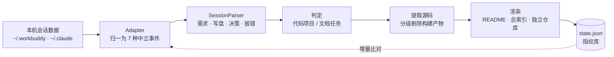
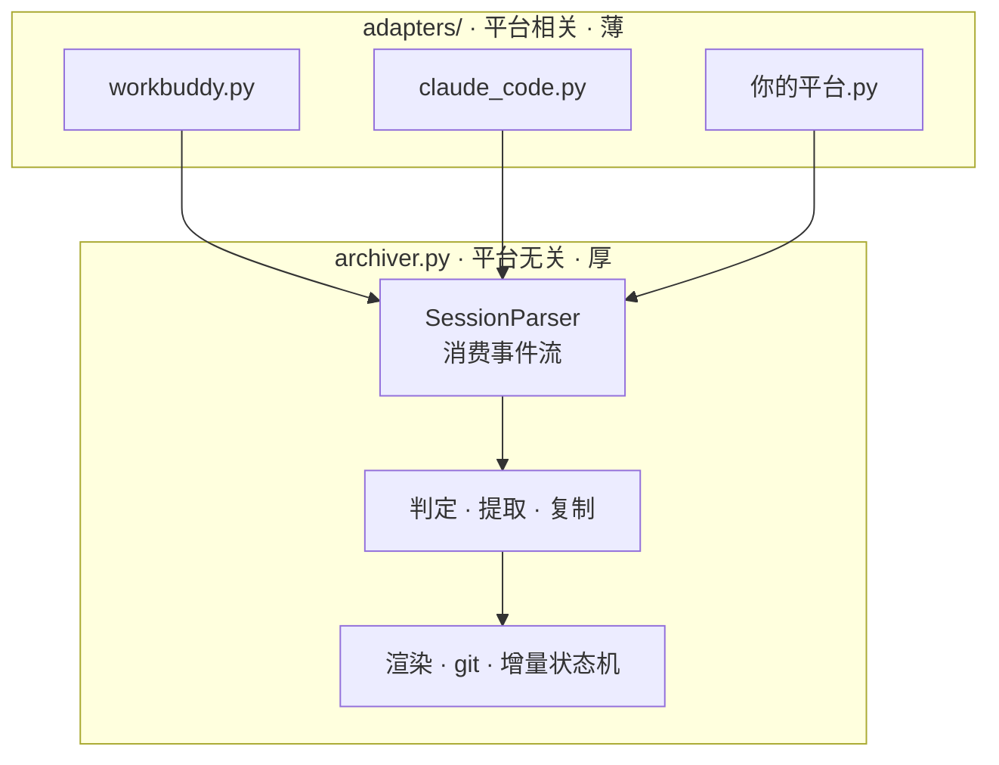

# 🗂️ 对话项目归档器 · 把 AI 对话里的软件收拢成可继续开发的源码档案

[中文](README.md) · [English](README.en.md)

**读本机会话 → 识别项目 → 归档纯源码 → 一键跳回原对话。**

> 对话里做出来的软件，三个月后连自己都找不到源码在哪——这个工具负责把它们收回来。

<p align="center">
  <a href="./LICENSE"></a>
  
  
  
  
</p>

<p align="center">
  <a href="https://github.com/winrich/dev-project-archivist" target="_blank">
    
  </a>
  <a href="https://github.com/winrich/dev-project-archivist/commits/main" target="_blank">
    
  </a>
  
</p>

<table align="center">
  <tr>
    <td align="center"><b>📦 27 个项目</b><br/><sub>单机实测归档规模</sub></td>
    <td align="center"><b>📉 91 → 49 MB</b><br/><sub>只留源码后的体积</sub></td>
    <td align="center"><b>⚡ 0 依赖</b><br/><sub>纯 Python 标准库</sub></td>
    <td align="center"><b>🔗 一键回原对话</b><br/><sub>随时接着往下做</sub></td>
  </tr>
</table>

> ⭐ **如果这个工具帮你找回了几个以为已经丢失的项目，请给个 Star。**

---

## 🤔 你是不是也这样

AI 让写软件变简单了，但**做出来的东西散在对话里**，于是新的麻烦来了：

- 😫 半年前用对话做的小工具，现在连源码落在哪个窗口都找不到
- 😫 项目散在几十个会话里，逐个复制粘贴永远做不完
- 😫 想接着改，却想不起当时为什么这么设计、踩过哪些坑
- 😫 想全量备份吧，`node_modules`、截图、构建产物占了九成体积
- 😫 终于收拢了源码，换台机器或交给别人，工程就跑不起来了
- 😫 归档目录越滚越大，`git clone` 一次要等好几分钟

**这个工具把这件事做成一条流水线**：扫描会话 → 判定项目 → 提取源码 → 渲染文档 → 增量同步。跑完打开 `INDEX.md`，每个项目都是能独立 `git clone` 继续开发的仓库。

---

## 🗺️ 它和别的做法有什么不同

| 做法 | 你拿到什么 | 代价 |
|---|---|---|
| 手动复制粘贴 | 只有你想得起来的那几个 | 耗时，且漏掉的永远漏掉 |
| 整目录打包备份 | 源码连同依赖、截图、构建产物 | 几十 GB，clone 不动，交不了人 |
| 把会话全喂给大模型 | 一段读起来不错的描述 | 没有源码，费用高，隐私还得赌 |
| **本工具** | 纯源码 + 项目背景 + 分模块功能 + 技术实现 + 回原对话入口 | 一条命令，零依赖 |

---

## 🎯 先确认：你要的是工具，还是某个项目

| 你的目的 | 应该怎么做 |
|---|---|
| 我自己也在用 AI 编程工具，想把**我自己的**对话项目收拢 | 装本工具（继续往下读） |
| 我只想接手别人做好的某个项目继续开发 | **不要装工具**，直接拿那个项目目录（含 `source/`、`.git/`、`README.md`），`git clone` 或解压即可开工 |
| 我想把自己的某个项目移交给别人 | 见下方「移交某个项目给他人」一节 |

本工具不含任何项目数据，它只负责把**本机会话**变成源码档案。别人的会话在别人机器上，装了也扫不到。

---

## 🧠 30 秒看懂

```bash
# 1. 先看分类，不写任何文件
python ~/.workbuddy/skills/dev-project-archivist/scripts/archiver.py scan --dry-run

# 2. 正式归档
python ~/.workbuddy/skills/dev-project-archivist/scripts/archiver.py run
```

第一条只打印一张分类表：扫到多少项目单元、哪些判为代码项目、哪些是纯文档任务。**首次务必先跑它**，确认分类符合预期再落盘。

第二条 `run` = 采集 + 渲染。完成后打开归档目录的 `INDEX.md`。默认输出到 `~/Workbuddy项目归档`，改位置有两种方式：

```bash
# 命令行指定
python .../archiver.py run --target "D:\我的归档"

# 或设环境变量（Windows，设一次，之后免传参）
[Environment]::SetEnvironmentVariable("ARCHIVER_TARGET", "D:\我的归档", "User")
```

---

## 🏗️ 工作流程



一句话版本：

```text
归档 = 读会话 + 判项目 + 剔噪声 + 抽源码 + 写文档 + 建仓库 + 记指纹
```

真正干活的是**确定性解析**，模型只负责最后一步「把文件清单和需求演进写成一段人话」。这条分工决定了三件事：结果可复现、不依赖联网、费用可控。

---

## 🧩 架构：一层薄适配，一层厚逻辑

平台差异全部收在 `adapters/` 里，主程序不认识任何一家工具的 JSON 结构：



适配器与主程序之间只有一份契约——**7 种中立事件**：

```text
ts / title / prompt / assistant / tool / write / tool_result
```

新增一个平台 = 在 `adapters/` 加一个文件 + 调一次 `register()`，主程序**一行都不用改**。见下方「接入其他工具」。

---

## 📐 六条设计约束

这不是「随手写的归档脚本」，下面每一条都是踩过坑之后才定下来的：

| 约束 | 具体做法 | 换来什么 |
|---|---|---|
| 只要源码 | 构建产物、依赖包、日志、截图、测试样本、一次性脚本全部剔除，逐项登记在 `manifest.json` | 单项目从 MB 级降到几十 KB ~ 几 MB |
| 目录要能独立开工 | 每个项目一个独立 git 仓库 + `.gitignore` | 打包发给别人，`git clone` 就能继续开发 |
| 剔除必须可追溯 | `manifest.json` 记录每个剔除项与外部依赖，另有 `_evidence/` | 怀疑少文件时有据可查，而不是靠猜 |
| 渲染必须幂等 | 生成逻辑纯函数化，连续跑两次 0 变化 | 才敢每天定时跑，不怕抖动 |
| 增量必须便宜 | 三级指纹（工作区 / 文件 / 内容 sha1） | 稳定期不重复解析、不重复调模型 |
| 没模型也要能用 | 摘要缺失时走模板兜底 `derive_from_manifest` | 零 API Key 也能产出完整档案 |

---

## 📦 输出长什么样

```
<归档目录>/
├── INDEX.md          # 总索引：项目/首次开发/最后开发/最后更新/类型/语言/会话/文件/用途
├── index.json        # 机器可读清单
├── CHANGELOG.md      # 每次运行的变更记录（新增/更新/失联/软删除）
├── overrides.json    # 人工校正表：改标题/背景/用途，keep_scripts 放行被误剔脚本
├── state.json        # 指纹库，增量同步的依据
├── _trash/           # 不再归档的项目目录（软删除，可人工恢复）
└── 2026-03-15_批量重命名工具/
    ├── README.md          # 背景 / 功能说明 / 技术实现 / 源码 / 原始对话 / 概览
    ├── manifest.json      # 元数据 + 剔除清单 + 外部依赖清单
    ├── .gitignore  .git/  # 独立仓库，首次归档即 init + commit
    ├── 打开原对话.bat      # 双击跳回最近一次会话
    ├── source/            # 纯源码，保持原相对路径
    ├── _docs/             # 设计文档（docx/pdf 等）
    ├── _evidence/evidence.md
    ├── _meta/
    │   ├── conversations.md  # 该项目全部用户指令原文（时序）
    │   ├── integrity.md      # 工程完整性核对
    │   ├── sessions.json
    │   └── memory/           # 该工作区的项目记忆
    └── _summary.json      # 归纳结果（无则模板兜底）
```

**目录刻意保持小**：只留源码、工程文件、配置与必要小资源。剔除项逐个登记可追溯，单个项目通常几十 KB 到几 MB。

---

## 🤖 支持哪些 AI 工具

| 工具 | 会话数据位置 | 状态 |
|---|---|---|
| WorkBuddy | `~/.workbuddy/` | ✅ 开箱即用，含 `workbuddy://` 深链 |
| Claude Code | `~/.claude/projects/` | ✅ 开箱即用，无深链时降级为 `claude --resume` 提示 |
| 其他本地 Agent | 需自行适配 | 见下方「接入其他工具」 |

用 `--source` 选择来源：默认 `all` 自动探测本机装了哪些，也可写 `workbuddy`、`claude-code` 或逗号组合。本机没有某个工具的数据时自动跳过，不会报错。

**为什么网页版 ChatGPT / Claude 不行**：它们把对话存在云端，代码从未以文件形式落到你的机器上，归档器拿不到「完整源码」这个最核心的交付物。本工具面向的是**能在本机写文件**的 Agent 类工具。

### 🔌 接入其他工具

`scripts/adapters/` 下每个文件对应一个平台。实现一个 `Adapter` 子类并在 `__init__.py` 末尾 `register()`：

```python
class MyAdapter(Adapter):
    name = "my-tool"           # 也是 --source 的取值
    display = "My Tool"
    def probe(self) -> bool: ...               # 本机是否存在该平台数据
    def load_index(self): ...                  # 返回 Index：ids() / info(sid) / transcript(sid)
    def iter_events(self, path, cwd=""): ...   # 逐条产出 7 种中立事件
```

事件规范与现成的辅助函数在 `scripts/adapters/base.py` 顶部。两条硬要求：`info()` 的 `created` / `updated` 必须是**毫秒整数**（否则跨平台排序会崩）；工具路径必须过 `rel_in_cwd()` 归一。改完运行 `python scripts/tests/test_adapters.py`。

---

## 🚀 快速开始

### 0. 环境要求

| 项目 | 要求 |
|---|---|
| 操作系统 | Windows / macOS / Linux |
| Python | 3.8 及以上（**无需 pip install**，只用标准库） |
| AI 工具 | 至少一个受支持工具的本地会话数据，见上节 |
| git | 可选。装了才能给每个项目初始化独立仓库；没装只有该步骤跳过，其余功能正常 |

### 1. 安装

**方式一：git clone（推荐，便于日后更新）**

```bash
# WorkBuddy
git clone https://github.com/winrich/dev-project-archivist.git ~/.workbuddy/skills/dev-project-archivist

# Claude Code
git clone https://github.com/winrich/dev-project-archivist.git ~/.claude/skills/dev-project-archivist
```

**方式二：压缩包**

解压后把整个 `dev-project-archivist` 目录放进对应工具的 skills 目录，确认最终路径为：

```
~/.workbuddy/skills/dev-project-archivist/SKILL.md     # WorkBuddy
~/.claude/skills/dev-project-archivist/SKILL.md        # Claude Code
```

装完**重启对应工具**，技能列表里才会出现。不装成技能也完全能用——直接跑命令行即可，归档逻辑不依赖宿主工具。

### 2. 跑起来

```bash
python ~/.workbuddy/skills/dev-project-archivist/scripts/archiver.py scan --dry-run   # 只看分类
python ~/.workbuddy/skills/dev-project-archivist/scripts/archiver.py run              # 正式归档
```

> 命令以 WorkBuddy 的安装路径为例。装在 Claude Code 下的，把 `~/.workbuddy/skills/` 换成 `~/.claude/skills/` 即可。

### 3. 在对话里用

重启后可直接对 AI 助手说：

> 把我在各个对话里开发的项目归档一下

技能会被自动唤起并执行同一套流程。

---

## 🆓 不配大模型也能用（零成本模式）

**「大模型归纳」是可选的。** 跳过它，归档同样完整，只是 README 里的项目名称沿用目录名、功能说明由文件清单自动推导：

```bash
python .../archiver.py run
```

`run` 不包含归纳步骤，渲染时自动走**模板兜底**（`derive_from_manifest`）。适合三类情况：不想配 API Key、不想产生任何模型费用；只想先把源码收拢好，说明文字日后再说；在他人机器上临时用一次。

**后续想升级成模型归纳**很简单：对某个项目补写 `_summary.json` 后重跑 `render` 即可，无需重新扫描。反之，删掉 `_summary.json` 再 `render` 会退回模板输出。

> 没有 `--no-llm` 之类的开关。是否调用模型，取决于你有没有执行归纳这一步。

**什么时候值得用模型归纳**：项目多、需要可读的项目名和成体系的功能说明时。夜间定时任务只对「有变化」的项目归纳，稳定期模型调用为 0。

---

## 🔗 回原对话继续开发

跳转方式按会话来源分派，没有深链能力的工具不会硬凑出点不开的链接。

| 平台 | 打开方式 |
|---|---|
| WorkBuddy | 点 README 里的「打开对话」，或双击项目根目录 `打开原对话.bat` |
| Claude Code | 项目根目录的 `打开原对话.md` 里记着会话 ID 与 `claude --resume <ID>` 命令 |

无论哪个平台，每个项目都有一份 `_meta/conversations.md`，按时间排列该项目**全部用户指令原文**，不跳转也能看清需求演进。

---

## 📚 命令一览

| 命令 | 作用 |
|---|---|
| `scan` | 采集/提取/复制源码，写证据包与待归纳清单 |
| `scan --dry-run` | 只打印分类表，零写入（**首次校准必用**） |
| `scan --force` | 忽略指纹强制重扫（换机、改规则后用） |
| `scan --only 关键字` | 只处理名称/路径/会话标题/归档目录名命中的项目 |
| `scan --limit N` | 只处理最近 N 个项目 |
| `render` | 由摘要生成 README 与总索引（幂等，可反复跑） |
| `run` | scan + render |
| `--source all\|workbuddy\|claude-code` | 选择数据来源，默认 `all` 自动探测；可逗号组合 |
| `pending` | 列出证据有变化、需要重新归纳的项目路径 |
| `status` | 上次运行时间、失联项目、缺摘要项目 |
| `git-clean` | 重建本工具创建的仓库，清掉历史提交里的大对象 |

---

## 🌙 每日自动同步（可选）

在你的 AI 工具里建一个定时任务（WorkBuddy 的自动化、系统计划任务均可），提示词分三步：`scan` → 读 `pending` 逐个归纳 → `render`。完整可粘贴的提示词见 [`references/automation-prompt.md`](references/automation-prompt.md)。

关键点：

- 只有**指纹变化**的项目才进 `pending`，稳定的日子里模型调用为 0
- 建议排在凌晨低峰，并绑到低价模型
- **定时任务里必须显式写 `--target`**，不要依赖环境变量

---

## ❓ 常见问题

**扫不到任何项目**
确认 `~/.workbuddy/projects/` 下有 `.jsonl` 转录文件。全新安装、从未对话过的环境里没有可归档内容。

**分类不准，把聊天当成了项目**
先 `scan --dry-run` 看分类表。判定规则是「源码文件数 ≥ 5 且不低于文档数的 30%」。调整阈值用 `--min-code N`；永久排除某工作区，在 `overrides.json` 里给它 `skip: true`。

**项目名或说明不对**
在 `overrides.json` 里按工作区路径或归档目录名覆盖 `title` / `background` / `purpose`，重跑 `render` 生效。

**核心脚本被误剔除了**
本工具会剔除形如 `repro_*`、`check_*`、`*_bak` 的一次性脚本。若误伤，在 `overrides.json` 加 `{"keep_scripts": ["文件名.py"]}` 后重跑 `scan --force`。

**某个项目一直显示「无变化」但确实改过**
`scan --force --only 关键字`。

**索引里出现 ⚠️ 失联**
原工作区已被删除，档案与源码副本仍完整保留。

**项目目录体积偏大**
查看 `manifest.json` 的 `excluded.external` 与 `source/` 下的大文件。默认单文件 5 MB、单项目源码 40 MB、资源阈值 256 KB，超出只登记不复制。

**git 仓库体积异常**
归档规则改过之后，历史提交里可能还留着旧的大文件：`python .../archiver.py git-clean`。

---

## 📤 移交某个项目给他人

归档目录里每个项目都是**独立的 git 仓库**，直接打包或推送即可：

```bash
cd <归档目录>/2026-03-15_批量重命名工具
git remote add origin <你的远端地址>
git push -u origin master
```

对方 `git clone` 后，按 `README.md` 的「技术实现」与 `_meta/integrity.md` 的完整性报告即可接手继续开发。

---

## 📁 项目结构

```text
dev-project-archivist/
├── SKILL.md                        # 技能入口：触发条件与执行规范
├── README.md  README.en.md         # 中文 / 英文说明
├── scripts/
│   ├── archiver.py                 # 流水线主程序（约 2300 行，纯标准库）
│   ├── adapters/
│   │   ├── base.py                 # 中立事件契约、Adapter 基类、多源聚合
│   │   ├── workbuddy.py            # WorkBuddy 会话索引与解析
│   │   ├── claude_code.py          # Claude Code JSONL 解析
│   │   └── __init__.py             # 注册表与 --source 选择
│   └── tests/
│       └── test_adapters.py        # 适配器单元测试
├── references/
│   ├── automation-prompt.md        # 夜间定时任务的可粘贴提示词
│   └── data-sources.md             # 本机数据源结构说明（排查用）
└── LICENSE                         # MIT
```

---

## 🤝 贡献

欢迎 Issue 和 PR，尤其欢迎这几类：

- 新增其他 AI 工具的适配器（Codex CLI / Cline / Roo Code / Cursor）
- 修正某类工程被误剔或漏抽的文件规则
- 改进 README 渲染的可读性
- 英文文档的措辞修正

提交前请跑一遍：

```bash
python scripts/tests/test_adapters.py
python scripts/archiver.py scan --dry-run
```

---

## 📄 License

[MIT](LICENSE)

---

<p align="center">
  ⭐ <b>如果这个项目对你有帮助，请给个 Star 支持一下。</b> ⭐
</p>
