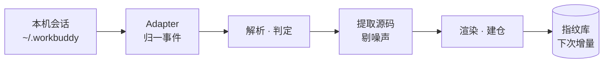
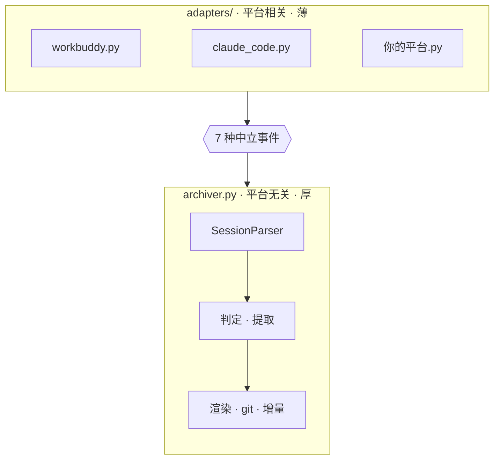

# 🗂️ 对话项目归档器 · 把 AI 对话里的软件收拢成可继续开发的源码档案

[中文](README.md) · [English](README.en.md)

**读本机会话 → 识别项目 → 归档纯源码 → 一键跳回原对话。**

> 对话里做出来的软件，三个月后连自己都找不到源码在哪——这个工具负责把它们收回来。

<p align="center">
  <a href="https://github.com/winrich/dev-project-archivist/releases"></a>
  <a href="./LICENSE"></a>
  
  
  
  
</p>

<p align="center">
  <a href="https://github.com/winrich/dev-project-archivist" target="_blank">
    
  </a>
  <a href="https://github.com/winrich/dev-project-archivist/commits/main" target="_blank">
    
  </a>
  
</p>

<table align="center">
  <tr>
    <td align="center"><b>📦 27 个项目</b><br/><sub>单机实测归档规模</sub></td>
    <td align="center"><b>📉 91 → 49 MB</b><br/><sub>只留源码后的体积</sub></td>
    <td align="center"><b>⚡ 0 依赖</b><br/><sub>纯 Python 标准库</sub></td>
    <td align="center"><b>🔗 一键回原对话</b><br/><sub>随时接着往下做</sub></td>
  </tr>
</table>

> ⭐ **如果这个工具帮你找回了几个以为已经丢失的项目，请给个 Star。**

---

## 🤔 你是不是也这样

AI 让写软件变简单了，但**做出来的东西散在对话里**，于是新的麻烦来了：

- 😫 半年前用对话做的小工具，现在连源码落在哪个窗口都找不到
- 😫 项目散在几十个会话里，逐个复制粘贴永远做不完
- 😫 想接着改，却想不起当时为什么这么设计、踩过哪些坑
- 😫 想全量备份吧，`node_modules`、截图、构建产物占了九成体积
- 😫 终于收拢了源码，换台机器或交给别人，工程就跑不起来了
- 😫 归档目录越滚越大，`git clone` 一次要等好几分钟

**这个工具把这件事做成一条流水线**：扫描会话 → 判定项目 → 提取源码 → 渲染文档 → 增量同步。跑完打开 `INDEX.md`，每个项目都是能独立 `git clone` 继续开发的仓库。

---

## 🗺️ 它和别的做法有什么不同

| 做法 | 你拿到什么 | 代价 |
|---|---|---|
| 手动复制粘贴 | 只有你想得起来的那几个 | 耗时，且漏掉的永远漏掉 |
| 整目录打包备份 | 源码连同依赖、截图、构建产物 | 几十 GB，clone 不动，交不了人 |
| 把会话全喂给大模型 | 一段读起来不错的描述 | 没有源码，费用高，隐私还得赌 |
| **本工具** | 纯源码 + 项目背景 + 分模块功能 + 技术实现 + 回原对话入口 | 一条命令，零依赖 |

---

## 🎯 先确认：你要的是工具，还是某个项目

| 你的目的 | 应该怎么做 |
|---|---|
| 我自己也在用 AI 编程工具，想把**我自己的**对话项目收拢 | 装本工具（继续往下读） |
| 我只想接手别人做好的某个项目继续开发 | **不要装工具**，直接拿那个项目目录（含 `source/`、`.git/`、`README.md`），`git clone` 或解压即可开工 |
| 我想把自己的某个项目移交给别人 | 见下方「移交某个项目给他人」一节 |

本工具不含任何项目数据，它只负责把**本机会话**变成源码档案。别人的会话在别人机器上，装了也扫不到。

---

## 🧠 30 秒看懂

命令分两组，别把两组的频率搞混：**`scan` / `render` 一个月跑几次，`find` / `stats` 天天用。**

**第一次用时（一次性）**

```bash
# 1. 先看分类，不写任何文件 —— 首次务必先跑它
python ~/.workbuddy/skills/dev-project-archivist/scripts/archiver.py scan --dry-run

# 2. 确认分类无误，正式归档（scan + render）
python ~/.workbuddy/skills/dev-project-archivist/scripts/archiver.py run
```

**之后每天用（都只读，不写文件）**

```bash
# 找东西：项目名 / 文件名 / 指令原文，多个词全部命中
python ~/.workbuddy/skills/dev-project-archivist/scripts/archiver.py find "批处理 转换"

# 看这周干了多少：对话 / 项目 / 改动文件 / token
python ~/.workbuddy/skills/dev-project-archivist/scripts/archiver.py stats --days 7

# 想给同事看，或想截图发人（单文件 HTML）
python ~/.workbuddy/skills/dev-project-archivist/scripts/archiver.py report --days 30 --open

# 回到上周三归档里的样子（先预览，加 --write 才落盘）
python ~/.workbuddy/skills/dev-project-archivist/scripts/archiver.py restore --date 2026-11-14
```

第一条只打印一张分类表：扫到多少项目单元、哪些判为代码项目、哪些是纯文档任务。**首次务必先跑它**，确认分类符合预期再落盘。

第二条 `run` = 采集 + 渲染。完成后打开归档目录的 `INDEX.md`。默认输出到 `~/Workbuddy项目归档`，改位置有两种方式：

```bash
# 命令行指定
python .../archiver.py run --target "D:\我的归档"

# 或设环境变量（Windows，设一次，之后免传参）
[Environment]::SetEnvironmentVariable("ARCHIVER_TARGET", "D:\我的归档", "User")
```

---

## 🏗️ 工作流程



「指纹库」记录工作区 / 文件 / 内容三级哈希，下次运行先比对再决定是否重新解析，这就是「稳定期不调模型」的原因。

一句话版本：

```text
归档 = 读会话 + 判项目 + 剔噪声 + 抽源码 + 写文档 + 建仓库 + 记指纹
```

真正干活的是**确定性解析**，模型只负责最后一步「把文件清单和需求演进写成一段人话」。这条分工决定了三件事：结果可复现、不依赖联网、费用可控。

---

## 🧩 架构：一层薄适配，一层厚逻辑

平台差异全部收在 `adapters/` 里，主程序不认识任何一家工具的 JSON 结构：



适配器与主程序之间只有一份契约——**7 种中立事件**：

```text
ts / title / prompt / assistant / tool / write / tool_result
```

新增一个平台 = 在 `adapters/` 加一个文件 + 调一次 `register()`，主程序**一行都不用改**。见下方「接入其他工具」。

---

## 📐 六条设计约束

这不是「随手写的归档脚本」，下面每一条都是踩过坑之后才定下来的：

| 约束 | 具体做法 | 换来什么 |
|---|---|---|
| 只要源码 | 构建产物、依赖包、日志、截图、测试样本、一次性脚本全部剔除，逐项登记在 `manifest.json` | 单项目从 MB 级降到几十 KB ~ 几 MB |
| 目录要能独立开工 | 每个项目一个独立 git 仓库 + `.gitignore` | 打包发给别人，`git clone` 就能继续开发 |
| 剔除必须可追溯 | `manifest.json` 记录每个剔除项与外部依赖，另有 `_evidence/` | 怀疑少文件时有据可查，而不是靠猜 |
| 渲染必须幂等 | 生成逻辑纯函数化，连续跑两次 0 变化 | 才敢每天定时跑，不怕抖动 |
| 增量必须便宜 | 三级指纹（工作区 / 文件 / 内容 sha1） | 稳定期不重复解析、不重复调模型 |
| 没模型也要能用 | 摘要缺失时走模板兜底 `derive_from_manifest` | 零 API Key 也能产出完整档案 |

---

## 📦 输出长什么样

```
<归档目录>/
├── INDEX.md          # 总索引：项目/首次开发/最后开发/最后更新/类型/语言/会话/文件/用途
├── index.json        # 机器可读清单
├── CHANGELOG.md      # 每次运行的变更记录（新增/更新/失联/软删除）
├── overrides.json    # 人工校正表：改标题/背景/用途，keep_scripts 放行被误剔脚本
├── state.json        # 指纹库，增量同步的依据
├── _trash/           # 不再归档的项目目录（软删除，可人工恢复）
├── _restore/         # restore 产出的历史快照副本（原归档不动）
└── 2026-03-15_批量重命名工具/
    ├── README.md          # 背景 / 功能说明 / 技术实现 / 源码 / 原始对话 / 概览
    ├── manifest.json      # 元数据 + 剔除清单 + 外部依赖清单
    ├── .gitignore  .git/  # 独立仓库，首次归档即 init + commit
    ├── open-session.bat  # 双击跳回最近一次会话（macOS/Linux 为 .command/.sh）
    ├── source/            # 纯源码，保持原相对路径
    ├── _docs/             # 设计文档（docx/pdf 等）
    ├── _evidence/evidence.md
    ├── _meta/
    │   ├── conversations.md  # 该项目全部用户指令原文（时序）
    │   ├── integrity.md      # 工程完整性核对
    │   ├── sessions.json
    │   └── memory/           # 该工作区的项目记忆
    └── _summary.json      # 归纳结果（无则模板兜底）
```

**目录刻意保持小**：只留源码、工程文件、配置与必要小资源。剔除项逐个登记可追溯，单个项目通常几十 KB 到几 MB。

---

## 🤖 支持哪些 AI 工具

| 工具 | 会话数据位置 | 状态 |
|---|---|---|
| WorkBuddy | `~/.workbuddy/` | ✅ 开箱即用，含 `workbuddy://` 深链 |
| Claude Code | `~/.claude/projects/` | ✅ 开箱即用，无深链时降级为 `claude --resume` 提示 |
| 其他本地 Agent | 需自行适配 | 见下方「接入其他工具」 |

用 `--source` 选择来源：默认 `all` 自动探测本机装了哪些，也可写 `workbuddy`、`claude-code` 或逗号组合。本机没有某个工具的数据时自动跳过，不会报错。

**为什么网页版 ChatGPT / Claude 不行**：它们把对话存在云端，代码从未以文件形式落到你的机器上，归档器拿不到「完整源码」这个最核心的交付物。本工具面向的是**能在本机写文件**的 Agent 类工具。

### 🔌 接入其他工具

`scripts/adapters/` 下每个文件对应一个平台。实现一个 `Adapter` 子类并在 `__init__.py` 末尾 `register()`：

```python
class MyAdapter(Adapter):
    name = "my-tool"           # 也是 --source 的取值
    display = "My Tool"
    def probe(self) -> bool: ...               # 本机是否存在该平台数据
    def load_index(self): ...                  # 返回 Index：ids() / info(sid) / transcript(sid)
    def iter_events(self, path, cwd=""): ...   # 逐条产出 7 种中立事件
```

事件规范与现成的辅助函数在 `scripts/adapters/base.py` 顶部。两条硬要求：`info()` 的 `created` / `updated` 必须是**毫秒整数**（否则跨平台排序会崩）；工具路径必须过 `rel_in_cwd()` 归一。改完运行 `python scripts/tests/test_adapters.py`。

---

## 🚀 快速开始

### 0. 环境要求

| 项目 | 要求 |
|---|---|
| 操作系统 | Windows / macOS / Linux |
| Python | 3.8 及以上（**无需 pip install**，只用标准库） |
| AI 工具 | 至少一个受支持工具的本地会话数据，见上节 |
| git | 可选。装了才能给每个项目初始化独立仓库；没装只有该步骤跳过，其余功能正常 |

### 1. 安装

**方式一：git clone（推荐，便于日后更新）**

```bash
# WorkBuddy
git clone https://github.com/winrich/dev-project-archivist.git ~/.workbuddy/skills/dev-project-archivist

# Claude Code
git clone https://github.com/winrich/dev-project-archivist.git ~/.claude/skills/dev-project-archivist
```

**方式二：压缩包**

解压后把整个 `dev-project-archivist` 目录放进对应工具的 skills 目录，确认最终路径为：

```
~/.workbuddy/skills/dev-project-archivist/SKILL.md     # WorkBuddy
~/.claude/skills/dev-project-archivist/SKILL.md        # Claude Code
```

装完**重启对应工具**，技能列表里才会出现。不装成技能也完全能用——直接跑命令行即可，归档逻辑不依赖宿主工具。

### 2. 跑起来

```bash
python ~/.workbuddy/skills/dev-project-archivist/scripts/archiver.py scan --dry-run   # 只看分类
python ~/.workbuddy/skills/dev-project-archivist/scripts/archiver.py run              # 正式归档
```

> 命令以 WorkBuddy 的安装路径为例。装在 Claude Code 下的，把 `~/.workbuddy/skills/` 换成 `~/.claude/skills/` 即可。

### 3. 在对话里用

重启后可直接对 AI 助手说：

> 把我在各个对话里开发的项目归档一下

技能会被自动唤起并执行同一套流程。

---

## 🆓 不配大模型也能用（零成本模式）

**「大模型归纳」是可选的。** 跳过它，归档同样完整，只是 README 里的项目名称沿用目录名、功能说明由文件清单自动推导：

```bash
python .../archiver.py run
```

`run` 不包含归纳步骤，渲染时自动走**模板兜底**（`derive_from_manifest`）。适合三类情况：不想配 API Key、不想产生任何模型费用；只想先把源码收拢好，说明文字日后再说；在他人机器上临时用一次。

**后续想升级成模型归纳**很简单：对某个项目补写 `_summary.json` 后重跑 `render` 即可，无需重新扫描。反之，删掉 `_summary.json` 再 `render` 会退回模板输出。

> 没有 `--no-llm` 之类的开关。是否调用模型，取决于你有没有执行归纳这一步。

**什么时候值得用模型归纳**：项目多、需要可读的项目名和成体系的功能说明时。夜间定时任务只对「有变化」的项目归纳，稳定期模型调用为 0。

---

## 🔗 回原对话继续开发

跳转方式按会话来源分派，没有深链能力的工具不会硬凑出点不开的链接。

| 平台 | 打开方式 |
|---|---|
| WorkBuddy | 点 README 里的「打开对话」，或运行项目根目录的 `open-session.bat`（macOS `.command` / Linux `.sh`） |
| Claude Code | 项目根目录的 `open-session.md` 里记着会话 ID 与 `claude --resume <ID>` 命令 |

无论哪个平台，每个项目都有一份 `_meta/conversations.md`，按时间排列该项目**全部用户指令原文**，不跳转也能看清需求演进。

---

## 📚 命令一览

| 命令 | 作用 |
|---|---|
| `scan` | 采集/提取/复制源码，写证据包与待归纳清单 |
| `scan --dry-run` | 只打印分类表，零写入（**首次校准必用**） |
| `scan --dry-run --all` | 连空壳会话一起列出（默认折叠，只报计数） |
| `scan --explain [关键字]` | 打印判定依据：凭什么算代码项目、名字取自哪个证据（零写入） |
| `scan --force` | 忽略指纹强制重扫（换机、改规则后用） |
| `scan --only 关键字` | 只处理名称/路径/会话标题/归档目录名命中的项目 |
| `scan --limit N` | 只处理最近 N 个项目 |
| `render` | 由摘要生成 README 与总索引（幂等，可反复跑） |
| `run` | scan + render |
| `--source all\|workbuddy\|claude-code` | 选择数据来源，默认 `all` 自动探测；可逗号组合 |
| `pending` | 列出证据有变化、需要重新归纳的项目路径 |
| `status` | 上次运行时间、失联项目、缺摘要项目、`.git` 体积体检 |
| `git-clean` | 重建本工具创建的仓库，清掉历史提交里的大对象 |
| `daylog --date 2026-11-18` | **零写入预览**：按天汇总开发活动（指令/写入/时长），并体检数据完整性 |
| `daylog --date 2026-11-18 --json` | 同上，输出 JSON 供脚本或大模型消费 |
| `daylog --date 2026-11-18 --merge-external` | 把工作区外的写入按仓库提升为独立行（默认只在体检里计数） |
| `log --date 2026-11-18` | **写出清点稿** `logs/2026-11-18.md`：确定性输出、幂等、已脱敏 |
| `find 关键词` | **跨项目检索**：名字/文件名/指令原文，多个词全部命中才计入（只读） |
| `find 关键词 --open` | 命中后直接打开第一条的原对话 |
| `find 关键词 --json` | 输出 JSON，供脚本或大模型消费 |
| `stats` | **跨天账本**：最近 7 天的对话/项目/文件/token，含每日柱状（只读） |
| `stats --days 30` | 回溯 30 天；配合 `--date` 指定截止日 |
| `stats --days 30 --json` | 输出 JSON，供脚本或大模型消费 |
| `report` | **写一份单文件 HTML 账本**（默认最近 30 天，可截图、可直接发人） |
| `report --days 7 --open` | 生成立即用浏览器打开 |
| `report --out 目录` | 指定输出目录，默认 `<target>/report` |
| `restore` | 列出**能回到哪些天**（各归档仓库有提交的日子） |
| `restore --date 2026-11-14` | **预览**那天结束时的快照：项目/文件/体积，零写入 |
| `restore --date 2026-11-14 --write` | 展开成副本到 `<target>/_restore/2026-11-14/`，**不覆盖归档** |
| `restore --date 2026-11-14 --write --only 关键字` | 只恢复名称匹配的项目 |
| `restore --date 2026-11-14 --json` | 输出 JSON，供脚本或大模型消费 |

## 🏷️ 项目名从哪来

名字按「证据强度」取，不猜：

| 顺序 | 证据 | 例 |
|---|---|---|
| 1 | 你自己改的名字（`overrides.json`） | — |
| 2 | git 远端仓库名 | `order-sync` |
| 3 | 工程清单（`package.json` / `*.csproj` / `pyproject.toml` / `go.mod` / `*.sln`） | `BatchRenamer` |
| 4 | 工作区目录名（平台自动生成的时间戳目录除外） | `CDN` |
| 5 | 会话标题（兜底） | `修复导入菜单无法打开窗体` |

**为什么不让会话标题优先**：标题是「你随口说的那句话」，不是「项目叫什么」。拿前者当后者，会得到叫 `https`、`密码为什么为空 LoginPanel` 的项目——这是旧版真实踩过的坑。

想知道某个项目凭什么被判成代码项目、名字又是从哪来的：

```bash
python .../archiver.py scan --explain BatchRenamer
```

```text
BatchRenamer  →  代码项目（置信度 高）
  工作区    D:/code/BatchRenamer
  文件      源码 147（阈值 5）· 文档 30 · 合计 191 个 / 170.0 MB
  入口      BatchRenamer.sln、BatchRenamer/BatchRenamer.csproj
  命名      BatchRenamer   ← git remote origin
  会话      2 个 · 2026-06-25 → 2026-07-01
```

`status` 里还有一项 `.git` 体积体检：某个仓库超过 200MB 会提示手动 `git gc`。**不做自动 gc**——它会在每日定时任务里拖长执行时间，得不偿失。

## 🔍 找回做过的东西：`find`

归档是仓库，`find` 是门。没有它，27 个项目就是一个必须逐个翻的博物馆。

```bash
$ python .../archiver.py find "批处理 PowerShell"

3 条命中 · 用时 0.21s

InvoiceParser  ·  2026-11-12 → 2026-11-15  ·  评分 24
  工作区  D:/code/InvoiceParser
  [指令] 2026-11-12 21:04  写个批处理把 build.bat 转成 ps1，顺便带上参数
  [文件] source/tools/convert.ps1

  → 直接回场：python .../archiver.py find "批处理 PowerShell" --open
```

四条设计取舍：

| 取舍 | 为什么 |
|---|---|
| 多个词是**全部命中**而不是任一命中 | 「批处理 转换」里两个词各命中一个项目，结果会糊成一片 |
| 词可以跨字段组合 | 「报表」在项目名里、「插值」在指令里，合起来才是用户要的那个 |
| 命中数量**饱和处理** | 有的项目带 2000 个备份文件，纯按数量加权会让它压过名字命中 |
| 摘要只算 1 分 | 摘要由模型生成，命中它不代表你真在这里干过这件事 |

命中位置与权重：**项目名 10 > 文件名 3 > 指令原文 3 > 摘要 1**（后三类按数量递增，上限 +6）。

| 参数 | 作用 |
|---|---|
| `--open` | 直接打开第一条命中的原对话（复用项目里的深链） |
| `--all` | 连「只命中摘要」的弱命中一起列（默认折叠） |
| `--json` | 机器可读，供脚本或大模型消费 |

检索**只读**：不加锁、不写文件、不调模型。本机 8 个项目（含一个 2200 文件的备份类项目）实测 0.2 秒。

## 📊 这周干了多少：`stats`

```bash
python ~/.workbuddy/skills/dev-project-archivist/scripts/archiver.py stats --days 7
```

```text
  最近 7 天 · 2026-11-13 → 2026-11-19

  对话 327 · 会话 6 · 项目 6 · 改动文件 172（写 155 / 改 17）
  Token 输入 936.0M（缓存命中 99%）· 输出 5.3M · 合计 941.4M
  成本：不估算（模型归属常为 auto，拿默认单价顶替等于编数字）

  每日对话  ▁▄█▂▂▂▁

  日期         对话   项目   文件    token
  ----------------------------------------
  11-13           6      1     10    20.7M
  11-14          82      2     87   421.3M
  ...

  最活跃项目
     276 对话 · 103 文件 ·  757.8M tok   熟悉阅读器桌面插件代码
```

新用户**第一天**就有数据可用——它只读本机已有的转录，不要求你先跑过 `scan`。

三条设计约束：

| 约束 | 原因 |
|---|---|
| **不估算成本** | WorkBuddy 的 `providerData.requestModelName` 常为 `auto`，按默认单价算等于编数字；只报 token，成本留给已知单价的场景 |
| **只算 input + output** | `cache_read` 是 input 的子集，三个分量相加会把输入算成两倍（这个坑踩过两次，`tok_total()` 里写了注释） |
| **与 `daylog` 同一套聚合** | `stats` 与 `daylog` 都走 `collect_range` → `_aggregate_day`，同一个数字在两处对不上，用户就再也不会相信任何一个 |

多天统计**只解析一次转录**：先按天分桶再合并，而不是循环调用 `collect_day`（那会把 735MB 转录解析 7 遍）。

---

## 🖼️ 把它发给别人：`report`

`stats` 是给自己看的，`report` 是给**别人**看的——一份自包含的 HTML，双击就开，没有任何依赖：

```bash
python .../archiver.py report --days 30 --open
```

页面上一共四块：四张总览卡（对话 / 项目 / 改动文件 / token）、日历热力图 + 三条事实（最忙的一天、活跃天数、平均每天）、每日对话量柱状图、按对话量排序的项目卡片。浅色深色都跟系统走，窄屏自动单列。

**能分享，和敢分享，是两件事。** 报告默认做了这些取舍：

| 报告里有什么 | 报告里没有什么 |
|---|---|
| 项目名（取自 git 仓库名 / 工程清单 / 目录名，与 `--dry-run` 同一套证据链） | **工作区绝对路径**（含用户名、内网目录） |
| 对话数、改动文件数、token 用量、起止日期 | **指令原文**（可能含代码、密钥、私事） |
| 日历热力图、柱状图、排名 | 任何 `<script>`、外链样式、远程字体 |

配套的硬约束：

| 约束 | 原因 |
|---|---|
| 项目名先 `desensitize()` 再判敏感 | 目录名可能是 `.ssh`、`access_token=xxx`；命中就显示“（名称含敏感信息，已隐藏）”，宁可少一个项目 |
| 所有动态文本过 `_rep()` 转义 | 项目名来自用户的目录名，`<script>` 和 `"` 都可能出现 |
| 唯一的外链是页脚仓库地址 | 纯文本链接，不加载任何资源——离线、内网、别人机器上都不会白屏 |
| 同一区间重复跑 → 逐字节相同 | 没有“生成于 12:34:56”这类时间戳，文件名只由区间决定，不会每天多一个文件 |

输出路径：`<target>/report/report-2026-10-21_2026-11-19.html`（区间由 `--days` 和 `--date` 决定）。

---

## 📅 按天汇总：`daylog`

归档回答的是「这个项目是什么」，`daylog` 回答的是「**今天做了什么**」。两者用的是同一批转录，但聚合维度相反：

```bash
python .../archiver.py daylog --date 2026-11-18          # 预览，不写任何文件
python .../archiver.py daylog --date 2026-11-18 --json   # 机器可读
```

归档到日志之间差的不是一次聚合，而是**五层语义**，`daylog` 把这五层都补上：

| 能力 | 为什么归档做不到 |
|---|---|
| 把**会话**按天切开 | 归档只记首末时间；一个跨三天的会话在日志里必须拆成三条 |
| 记录**编辑**动作的文件路径 | 归档只抽 `Write` 的完整正文，`Edit` 的路径原先被整体丢弃 |
| **指令 → 产出**配对 | 只按天收集，写日志时还得人脑把「说了什么」和「改了哪些文件」对齐 |
| 命令**用途**归类 | 原始命令带着 `cd … &&` 前缀，不归一会全部沉进「其它」 |
| **token 用量** | 平台写在每次模型调用上，归档不需要；但没有它就算不出「这件事花了多少」 |

输出是一张按工作区排的表，加三段汇总和一段**数据完整性体检**：

```text
工作区                                          会话  指令   写   改   工具   命令  跨度
----------------------------------------------------------------------------------------
C:/Users/me/WorkBuddy/2026-11-16-20-46-15       1    29    6    5    761    429  00:00-23:11

动作构成      写盘 209 · 读 110 · 命令 430 · 其它 15
命令用途      git 26 · 脚本 98 · 查看 281 · 其它 25
token 用量    输入 89.01M · 输出 501.7k · 其中缓存命中 88.24M（99%）

数据完整性
  · 无时间戳事件      0   （事件都带 ts，时间粒度可用）
  · 写盘调用          209 次
      工作区内         64
      工作区外        145   ← 未计入上表，别处的写入
  · 重复指令已压重     34   ← 上下文压缩导致的原文重放
  · 跨天会话          0
  · 无 token 记录的会话 0 / 已解析 2   （成本侧数据完整）
```

明细区按**轮次**展示，每条指令后面直接跟它造成的产出（文件、构建/测试、错误、token）：

```text
  13:35  从远端同步代码下来
           → 7 文件 · git×6 · 查看×1 · 12.3k tok
```

那几行体检不是装饰——它们决定这张表能不能信：

- **无时间戳事件 > 0**：说明有事件归不到任何一天，日志会缺内容，该查适配器。
- **工作区外写入**占比高：说明这个会话实际在别的目录干活，工作区划分有问题。
- **重复指令已压重**：上下文压缩会把早先的提问原样重放一遍，不压重会「一条需求写三遍」。
- **跨天会话**：正常现象，说明按天切分确实在工作。
- **无 token 记录 > 0**：该平台不写 usage，成本侧只能留空。**不能拿 0 顶替**——那会让「便宜」和「没数据」在报表里长得一样。

⚠️ 缓存命中率常年接近 99%，这是长会话反复复用上下文的正常结果，不是统计错误。
换算成本时按 `全价部分 = 输入 − 缓存命中` 拆分，两者不能相加（`total = input + output` 已经成立）。

`daylog` 目前**只读**：不产生文件、不调用模型、不改归档目录。要生成日志文件是下一步的事，先把数据验准。

---

## 📝 落盘：`log`

`daylog` 是给人看的预览，`log` 才是产物。同一次聚合，输出成一份可归档、可投递的 Markdown：

```bash
python .../archiver.py log --date 2026-11-18                    # 写到 <target>/logs/2026-11-18.md
python .../archiver.py log --date 2026-11-18 --out ./logs       # 指定目录
python .../archiver.py log --date 2026-11-18 --no-merge-external  # 不并列区外改动
```

它只做**清点**，不做归纳：

| 写了什么 | 为什么这样切 |
|---|---|
| 每个项目一段：时段、指令数、文件数、token 用量 | 管理者要的是「这天在哪个项目上花了多少」 |
| 时间线：`指令 → 跑了什么 → 改了哪些文件 → 花了多少 token` | 每条都能回溯到证据，而不是一句「完成了若干优化」 |
| 工作区外的改动单列 | 会话 cwd 与实际干活目录不一致时，不列就是漏报 |
| 数据缺口一节 | 解析失败、无 token、无路径的写入都要显式说明，不能静默 |

**刻意不写「今日完成 / 进行中 / 阻塞」三节。** 那需要读懂上下文，属于模型该做的事；
用启发式（有没有报错、有没有文件）硬猜，产出的是看起来像结论的错误结论。
清点稿的职责是把证据摆齐，让归纳方有据可依——这也是它能做到**不调模型、确定性输出**的原因。

三条工程约束：

- **幂等**：同样的转录 → 同样的字节。第二次运行只打印「无变化」，不产生 diff，定时任务不会天天抖。
- **脱敏**：提示词过 `desensitize()`；区外路径里的 `.ssh` / `.aws` / `.env` / 密钥文件一律替换为「（敏感路径已隐藏）」，只计数不列名。
- **可回退**：只写 `logs/`，不碰归档目录，删掉即恢复原状。

---

## ⏪ 回到某天：`restore`

归档的价值不只在「再看一眼」，而在**能退回去**。每个项目目录本身就是一个 git 仓库，
每次扫描一次提交，于是「11 月 14 号那天，归档里是什么样」是个能被精确回答的问题：

```bash
python .../archiver.py restore                            # 第一步：能回到哪些天
python .../archiver.py restore --date 2026-11-14          # 第二步：预览，零写入
python .../archiver.py restore --date 2026-11-14 --write  # 第三步：真的展开成副本
```

```text
  可恢复的日期（各归档仓库有提交的日子，新 → 旧）

    2026-11-18    27 个仓库有提交 ·   27 次提交
    2026-11-17    25 个仓库有提交 ·   26 次提交
    2026-11-16    27 个仓库有提交 ·   27 次提交

  用法：restore --date 2026-11-18          只预览，不写任何文件
        restore --date 2026-11-18 --write  展开到 <target>/_restore/2026-11-18/
```

### 三条语义（先读这三条，再看参数）

| 它是 | 它不是 |
|---|---|
| **只从归档仓库自己的 git 历史取** | 不是从原工作区取——原工作区可能早就删了、改名了、被下一次对话覆盖了 |
| 「**那天结束时**归档里长什么样」 | **不是「那天改了什么」**。想知道那天干了什么，用 `log` / `stats`，不是 `restore` |
| 只包含**之前已经归档过**的文件 | 不是备份。媒体、超大二进制、敏感路径、`.gitignore` 排除的构建产物、**首次归档之前**的任何文件，从来不在快照里 |

前两条决定了两个边界，都必须显式说出来、不能静默少一行：

- **某天没跑归档** → 那天没有快照，恢复会退到**更早的最近一次提交**，并把那个提交的真实时间打在界面上，不假装是当天
- **项目晚于目标日期才第一次归档** → 不进恢复列表，而是出现在「无法恢复」里，理由写清：`该日之前没有归档记录（首次归档 2026-11-16）`

### 永远不覆盖归档

「回到某天」最典型的翻车方式是就地覆盖当前归档，所以这条在实现上是硬约束：
恢复只**读**归档仓库（`git archive`，连工作区和索引都不碰），写的目标是当天新建的独立目录。

| 参数 | 行为 |
|---|---|
| 默认（不带 `--write`） | 只预览：每个项目取到哪个提交、多少文件、多大体积，**零写入** |
| `--write` | 展开到 `<target>/_restore/<date>/<项目>/`，归档目录一个字节都不变 |
| `--out 目录` | 换输出位置（比如换个盘放副本） |
| `--only 关键字` | 只恢复名称匹配的项目 |
| `--force` | 同日已有副本时覆盖；总量超过 800MB 时确认执行 |
| `--json` | 机器可读，字段含每个项目的 `commit` / `snapshot_at` / `files` / `bytes` |

展开后目录里会多一份 `_restore.md` 和 `_restore.json`，记录每个项目**取自哪个 commit**，
事后可以逐条对账；副本不带 `.git`，拿去编译/打开就能用。

> 想就地回退**某一个**项目的归档内容？不用这个命令——归档目录本身就是仓库，
> 进项目目录 `git log` 挑一个提交、`git checkout <sha> -- .` 即可。
> `restore` 解决的是另一件事：要一份能直接打开、能编译的副本，同时不想动现在的归档。

---

## 🌙 每日自动同步（可选）
在你的 AI 工具里建一个定时任务（WorkBuddy 的自动化、系统计划任务均可），提示词分三步：`scan` → 读 `pending` 逐个归纳 → `render`。完整可粘贴的提示词见 [`references/automation-prompt.md`](references/automation-prompt.md)。

关键点：

- 只有**指纹变化**的项目才进 `pending`，稳定的日子里模型调用为 0
- 建议排在凌晨低峰，并绑到低价模型
- **定时任务里必须显式写 `--target`**，不要依赖环境变量

---

## ❓ 常见问题

**扫不到任何项目**
确认 `~/.workbuddy/projects/` 下有 `.jsonl` 转录文件。全新安装、从未对话过的环境里没有可归档内容。

**分类不准，把聊天当成了项目**
先 `scan --dry-run` 看分类表。判定规则是「源码文件数 ≥ 5 且不低于文档数的 30%」。调整阈值用 `--min-code N`；永久排除某工作区，在 `overrides.json` 里给它 `skip: true`。

**项目名或说明不对**
在 `overrides.json` 里按工作区路径或归档目录名覆盖 `title` / `background` / `purpose`，重跑 `render` 生效。

**核心脚本被误剔除了**
本工具会剔除形如 `repro_*`、`check_*`、`*_bak` 的一次性脚本。若误伤，在 `overrides.json` 加 `{"keep_scripts": ["文件名.py"]}` 后重跑 `scan --force`。

**某个项目一直显示「无变化」但确实改过**
`scan --force --only 关键字`。

**索引里出现 ⚠️ 失联**
原工作区已被删除，档案与源码副本仍完整保留。

**项目目录体积偏大**
查看 `manifest.json` 的 `excluded.external` 与 `source/` 下的大文件。默认单文件 5 MB、单项目源码 40 MB、资源阈值 256 KB，超出只登记不复制。

**git 仓库体积异常**
归档规则改过之后，历史提交里可能还留着旧的大文件：`python .../archiver.py git-clean`。

---

## 📤 移交某个项目给他人

归档目录里每个项目都是**独立的 git 仓库**，直接打包或推送即可：

```bash
cd <归档目录>/2026-03-15_批量重命名工具
git remote add origin <你的远端地址>
git push -u origin master
```

对方 `git clone` 后，按 `README.md` 的「技术实现」与 `_meta/integrity.md` 的完整性报告即可接手继续开发。

---

## 🧾 提交信息：那天到底做了什么

每个项目仓库在每次内容变化时自动提交，提交信息从**上次提交以来的对话指令**生成：

```text
sync: 修复导入菜单无法打开窗体 等 3 项

- 新增范围配置表 config_scope
- 调整科目卡片高度

X-Archiver: dev-project-archivist
```

于是 `git log --oneline` 不再是 27 行一模一样的 `sync: 同步 X 归档内容`，而是一条能读的时间线：

```bash
cd <归档目录>/2026-06-25_BatchRenamer
git log --oneline --no-merges | head -5
```

四条硬约束：

| 约束 | 原因 |
|---|---|
| **主题按信息量挑，不按时间挑** | 最新的那条常常是「还是不行」「继续」，当主题等于没写 |
| **先脱敏再截断** | 反过来会把 token 截成半截，正好躲过密钥正则 |
| **提到 `.ssh` / `.env` 的指令整条丢弃** | 提交会进 git 历史，路径本身就是信息 |
| **没有可用指令就退回原文案** | 宁可信息少，不可编造 |

提交体里带 `X-Archiver:` 标记：`git-clean` 靠它判断历史是否全由本工具产生，
**你手动提交过的仓库不会被重建**（v0.1.x 的老提交按文案前缀兼容）。

---

## 📁 项目结构

```text
dev-project-archivist/
├── SKILL.md                        # 技能入口：触发条件与执行规范
├── README.md  README.en.md         # 中文 / 英文说明
├── CHANGELOG.md                    # 版本记录与发版口径（版本号三处必须同步）
├── pyproject.toml                  # 可 pipx / uvx 安装（依赖仍为 0）
├── .github/workflows/ci.yml        # 2 个系统 × 3 个 Python 版本，跑全量 unittest discover
├── scripts/
│   ├── archiver.py                 # 主程序：归档 / 日志 / 检索 / 账本 / 恢复，纯标准库
│   ├── adapters/
│   │   ├── base.py                 # 中立事件契约、Adapter 基类、多源聚合
│   │   ├── workbuddy.py            # WorkBuddy 会话索引与解析
│   │   ├── claude_code.py          # Claude Code JSONL 解析
│   │   └── __init__.py             # 注册表与 --source 选择
│   └── tests/                      # 210 例，全部可离线跑
│       ├── test_adapters.py        # 适配器单元测试
│       ├── test_daylog.py          # 按天聚合（不丢不重）
│       ├── test_naming.py          # 命名证据链与标题清洗
│       ├── test_find.py            # 检索评分与同类饱和
│       ├── test_commit_msg.py      # 提交信息生成
│       ├── test_stats.py           # 跨天账本口径（与 daylog 一致）
│       ├── test_report.py          # HTML 报告结构与脱敏
│       ├── test_restore.py         # 按日恢复语义（临时 git 仓库）
│       ├── test_release.py         # 版本号三处一致
│       └── test_public_content.py  # 公开内容防泄漏：竞品名 / 带用户名的路径
├── references/
│   ├── automation-prompt.md        # 夜间定时任务的可粘贴提示词
│   └── data-sources.md             # 本机数据源结构说明（排查用）
└── LICENSE                         # MIT
```

---

## 🤝 贡献

欢迎 Issue 和 PR，尤其欢迎这几类：

- 新增其他 AI 工具的适配器（Codex CLI / Cline / Roo Code / Cursor）
- 修正某类工程被误剔或漏抽的文件规则
- 改进 README 渲染的可读性
- 英文文档的措辞修正

提交前请跑一遍：

```bash
python -m unittest discover -s scripts/tests   # 全量，210 例，离线可跑
python scripts/archiver.py scan --dry-run
```

改动记入 [CHANGELOG.md](CHANGELOG.md)。发版口径写在它的开头：版本号 = 已完成档位的最高一个，
`pyproject.toml` / `__version__` / `CHANGELOG` 首条目三处必须同数（`test_release.py` 会拦住不一致）。

---

## 📄 License

[MIT](LICENSE)

---

<p align="center">
  ⭐ <b>如果这个项目对你有帮助，请给个 Star 支持一下。</b> ⭐
</p>
