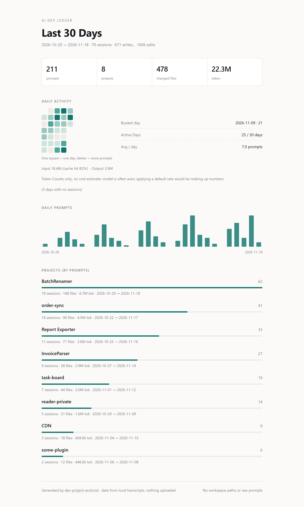
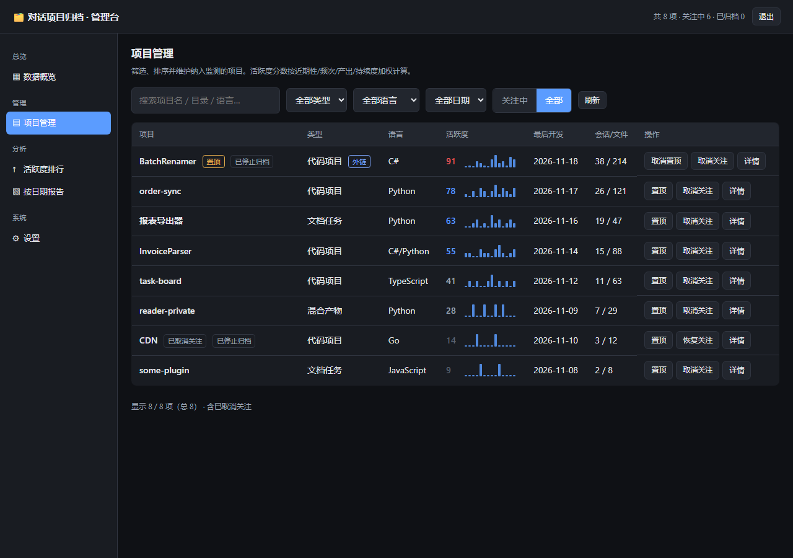
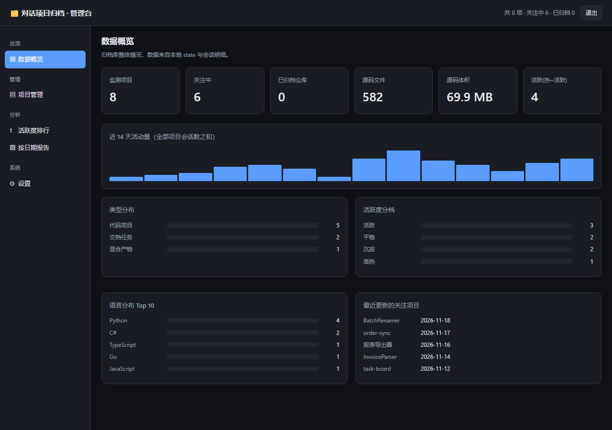
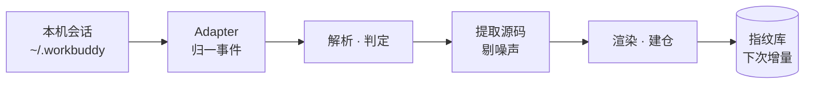

# 🗂️ 对话项目归档器 · 把 AI 对话里的软件收拢成可继续开发的源码档案

[中文](README.md) · [English](README.en.md)

**读本机会话 → 识别项目 → 归档纯源码 → 一键跳回原对话。**

> 对话里做出来的软件，三个月后连自己都找不到源码在哪——这个工具负责把它们收回来。

<p align="center">
  <a href="https://github.com/winrich/dev-project-archivist/releases"></a>
  <a href="./LICENSE"></a>
  
  
  
  
</p>

<p align="center">
  <a href="https://github.com/winrich/dev-project-archivist" target="_blank">
    
  </a>
  <a href="https://github.com/winrich/dev-project-archivist/commits/main" target="_blank">
    
  </a>
  
</p>

<table align="center">
  <tr>
    <td align="center"><b>📦 27 个项目</b><br/><sub>单机实测归档规模</sub></td>
    <td align="center"><b>📉 91 → 49 MB</b><br/><sub>只留源码后的体积</sub></td>
    <td align="center"><b>⚡ 0 依赖</b><br/><sub>纯 Python 标准库</sub></td>
    <td align="center"><b>🔗 一键回原对话</b><br/><sub>随时接着往下做</sub></td>
  </tr>
</table>

> ⭐ **如果这个工具帮你找回了几个以为已经丢失的项目，请给个 Star。**

---

## 🤔 你是不是也这样

AI 让写软件变简单了，但**做出来的东西散在对话里**，于是新的麻烦来了：

- 😫 半年前用对话做的小工具，现在连源码落在哪个窗口都找不到
- 😫 项目散在几十个会话里，逐个复制粘贴永远做不完
- 😫 想接着改，却想不起当时为什么这么设计、踩过哪些坑
- 😫 想全量备份吧，`node_modules`、截图、构建产物占了九成体积
- 😫 终于收拢了源码，换台机器或交给别人，工程就跑不起来了
- 😫 归档目录越滚越大，`git clone` 一次要等好几分钟

**这个工具把这件事做成一条流水线**：扫描会话 → 判定项目 → 提取源码 → 渲染文档 → 增量同步。跑完打开 `INDEX.md`，每个项目都是能独立 `git clone` 继续开发的仓库。

---

## 🗺️ 它和别的做法有什么不同

| 做法 | 你拿到什么 | 代价 |
|---|---|---|
| 手动复制粘贴 | 只有你想得起来的那几个 | 耗时，且漏掉的永远漏掉 |
| 整目录打包备份 | 源码连同依赖、截图、构建产物 | 几十 GB，clone 不动，交不了人 |
| 把会话全喂给大模型 | 一段读起来不错的描述 | 没有源码，费用高，隐私还得赌 |
| **本工具** | 纯源码 + 项目背景 + 分模块功能 + 技术实现 + 回原对话入口 | 一条命令，零依赖 |

---

## 🎯 先确认：你要的是工具，还是某个项目

| 你的目的 | 应该怎么做 |
|---|---|
| 我自己也在用 AI 编程工具，想把**我自己的**对话项目收拢 | 装本工具（继续往下读） |
| 我只想接手别人做好的某个项目继续开发 | **不要装工具**，直接拿那个项目目录（含 `source/`、`.git/`、`README.md`），`git clone` 或解压即可开工 |
| 我想把自己的某个项目移交给别人 | 见 [DEVELOPMENT.md](DEVELOPMENT.md) 的「移交某个项目给他人」 |

本工具不含任何项目数据，它只负责把**本机会话**变成源码档案。别人的会话在别人机器上，装了也扫不到。

---

## 🧠 30 秒看懂

命令分三组，别把频率搞混：**`scan` / `run` 一个月跑几次，`find` / `stats` / `report` / `restore` 天天用，`sync` 想起来才跑。**

每条命令后面都跟着它跑出来的样子。`…` 是省略的行，数字是虚构的，格式与对齐由真实打印代码生成。

### 第一次：先看它怎么分类，再落盘

**① 只分类，不写任何文件**

```bash
python ~/.workbuddy/skills/dev-project-archivist/scripts/archiver.py scan --dry-run
```

```text
[1/3] 会话索引：214 个会话，198 份转录
[2/3] 归并完成：8 个项目单元

日期        类型      语言              码   档  文件  项目
---------------------------------------------------------------------------------------------------
2026-10-20  代码项目  C#               298   14   312  BatchRenamer batch-renamer
2026-10-22  代码项目  Python            88    8    96  order-sync order-sync
2026-10-25  代码项目  Python            61    10    71  报表导出器 report-export
2026-10-27  混合产物  Python            44    14    58  InvoiceParser invoice-parser
2026-11-04  代码项目  TypeScript        15    3    18  CDN cdn-tools
2026-11-06  文档任务  —                  0   12    12  some-plugin some-plugin
…
---------------------------------------------------------------------------------------------------
小计：代码项目 5 / 文档任务 2 / 混合产物 1 / 空壳 0
```

一张表回答两个问题：扫到哪些项目、各自判成了什么（`码` = 源码文件数，`档` = 文档数）。**首次务必先跑它**——判定看的是工作区路径与文件构成，猜错的代价是归档里多出一堆垃圾目录。

**② 分类对了，正式落盘**

```bash
python ~/.workbuddy/skills/dev-project-archivist/scripts/archiver.py run
```

```text
[1/3] 会话索引：214 个会话，198 份转录
[2/3] 归并完成：8 个项目单元
  [1/8] = 无变化 BatchRenamer
  [2/8] + 2026-10-22_order-sync  (源码 96 个 / 1.2 MB，文档 1 个，剔除 24)
  [3/8] + 2026-10-25_报表导出器  (源码 71 个 / 941.4 KB，文档 3 个，剔除 41)
  …
[3/3] 扫描完成：更新 4 / 跳过 4 / 待归纳 2，耗时 12.4s
[render] README 更新 4 个，索引项目 8 个
```

`run` = 采集 + 渲染。`= 无变化` 是增量在生效（三级指纹没变就不重解析），`+` 是这次写了盘；括号里是源码份数、体积、剔除项。跑完打开归档目录的 `INDEX.md`，每个项目都在里面。

默认输出到 `~/Workbuddy项目归档`，改位置有两种方式：

```bash
# 命令行指定
python .../archiver.py run --target "D:\我的归档"

# 或设环境变量（Windows，设一次，之后免传参）
[Environment]::SetEnvironmentVariable("ARCHIVER_TARGET", "D:\我的归档", "User")
```

### 之后每天：四个只读命令

**找东西**

```bash
python ~/.workbuddy/skills/dev-project-archivist/scripts/archiver.py find "批处理 PowerShell"
```

```text
3 条命中 · 用时 0.21s

InvoiceParser  ·  2026-11-12 → 2026-11-15  ·  评分 24
  工作区  D:/code/InvoiceParser
  [指令] 2026-11-12 21:04  写个批处理把 build.bat 转成 ps1，顺便带上参数
  [文件] source/tools/convert.ps1

  → 直接回场：archiver.py find "批处理 PowerShell" --open
```

项目名、文件名、指令原文一起搜，多个词**全部命中**才计入；`--open` 直接打开第一条命中的原对话。只读，不写任何文件。

**这周干了多少**

```bash
python ~/.workbuddy/skills/dev-project-archivist/scripts/archiver.py stats --days 7
```

```text
  最近 7 天 · 2026-11-12 → 2026-11-18

  对话 60 · 会话 19 · 项目 5 · 改动文件 143（写 96 / 改 47）
  Token 输入 4.2M（缓存命中 82%）· 输出 900.0k · 合计 5.1M
  成本：不估算（模型归属常为 auto，拿默认单价顶替等于编数字）

  每日对话  ▂▁▅▆▃█▂

  日期         对话   项目   文件    token
  ----------------------------------------
  11-12           2      1      5   210.0k
  11-13           0      0      0        0
  11-14          12      3     28     1.0M
  11-15          16      3     38     1.4M
  11-16           6      2     14   510.0k
  11-17          21      4     50     1.7M
  11-18           3      1      8   260.0k

  最活跃项目
      21 对话 ·  50 文件 ·    1.7M tok   BatchRenamer
      18 对话 ·  41 文件 ·    1.5M tok   order-sync
      11 对话 ·  33 文件 ·  940.0k tok   报表导出器

  空白天    11-13（没有会话）
```

不要求先跑过 `scan`——它只读本机已有的转录，新用户第一天就有数。成本那栏永远写「不估算」：模型归属常是 `auto`，拿默认单价顶替等于编数字。

**想给同事看，或者截图发人**

```bash
python ~/.workbuddy/skills/dev-project-archivist/scripts/archiver.py report --days 30 --open
```

```text
已写入 C:/Users/me/Workbuddy项目归档/report/report-2026-10-20_2026-11-18.html
  30 天 · 8 个项目 · 211 条对话 · 22.3M token
  报告不含工作区路径与指令原文，可直接分享
```

单文件 HTML，双击就开，不发网络请求、不加载字体。页面本身长什么样，见下面「👀 长什么样」。

**回到上周三归档里的样子**

```bash
python ~/.workbuddy/skills/dev-project-archivist/scripts/archiver.py restore --date 2026-11-14
```

```text
  归档快照 2026-11-14（当天 23:59:59 之前最后一次提交）
  预览，未写任何文件

  项目                          快照时间             文件      体积
  ------------------------------------------------------------------
  2026-10-20_BatchRenamer       11-14 22:41            47    1.2 MB
  2026-10-22_order-sync         11-14 19:03            38  860.0 KB
  2026-10-25_报表导出器         11-14 16:27            21  420.0 KB
  2026-10-27_InvoiceParser      11-14 11:52            13  210.0 KB
  … 另 4 个

  小计 8 个项目 · 213 个文件 · 4.6 MB

    2026-10-20_BatchRenamer      4b7d2c19  批处理转换：把 build.bat 转成 ps1 等 3 项
    2026-10-22_order-sync        c81f5a3e  订单对账：先跑通一天再谈批量 等 2 项
    2026-10-25_报表导出器             2e9a06b7  导出加一列毛利率 等 4 项
    2026-10-27_InvoiceParser     d1c4f8a2  发票号从附件名里取，取不到就留空 等 2 项
    … 另 4 个，--json 看全部

  这只是预览。加 --write 才会展开成副本（不会改动归档本身）：
    restore --date 2026-11-14 --write
```

默认只预览：恢复动辄几百 MB，先看清「要拿回哪一版、多少文件」再决定。`--write` 展开到 `<归档目录>/_restore/2026-11-14/`，归档本身一个字节都不动；恢复不了的项目会单独列出来，并写明原因（仓库没提交 / 那天之前还没归档过）。

### 想起来才跑：把归档备到自己的仓库

```bash
python ~/.workbuddy/skills/dev-project-archivist/scripts/archiver.py sync          # 预览
python ~/.workbuddy/skills/dev-project-archivist/scripts/archiver.py sync --push   # 真推
```

```text
  归档仓库 8 个 · 配了远端 6 个 · 有未提交改动 3 个 · 待推送 5 个提交

  仓库                      分支     远端                           待提交  待推送
  ------------------------------------------------------------------------------
  2026-10-20_BatchRenamer   main     github.com/me/batch-renamer         2      +2
  2026-10-22_order-sync     main     github.com/me/order-sync            -       -
  2026-10-25_报表导出器     main     github.com/me/report-export         1      +2
  2026-10-27_InvoiceParser  main     github.com/me/invoice-parser        -      +1
  2026-10-29_reader-private main     github.com/me/reader-private        -       -
  2026-11-01_task-board     main     github.com/me/task-board            -       -

  2 个仓库没配远端（不会推送）。要备份到自己的仓库，在归档目录里各执行一次：
      git remote add origin <你的仓库地址>
  之后 `sync --push` 就会带上它们。

  这是预览，没有提交也没有推送。加 --push 才执行。
```

只推**自己配了远端**的仓库（不猜地址、不自动建远端）、**永不 force**、不进 `run`（定时任务不该依赖网络）。

---

## 👀 长什么样

先看产物，再决定要不要往下读。`report` 生成的账本页长这样：

<p align="center">
  
</p>

一份自包含的 HTML：双击就开，不发网络请求、不加载字体，能直接发给别人。四张总览卡（对话 / 项目 / 改动文件 / token）、日历热力图、每日对话量柱状图、按对话量排的项目卡。

**能分享，和敢分享，是两件事**：页面里没有工作区路径，没有指令原文，唯一的外链是页脚那几个字。

> 这张图来自 [`docs/sample/report-demo.html`](docs/sample/report-demo.html)，由 [`docs/sample/build_sample.py`](docs/sample/build_sample.py)
> 喂**虚构数据**给**同一个渲染函数**生成——项目名和数字都是编的，版式和你自己跑出来的那份一致。
> 改了样式，样例跟着变，不会漂。

其余命令的输出（分类表、命中列表、账本数字、恢复预览）都在上面「🧠 30 秒看懂」里——每条命令后面都跟着它跑出来的样子。

如果你更愿意**在浏览器里管**，还有一套只监听本机的后台管理台。项目列表、活跃度、数据概览长这样：

<p align="center">
  
</p>

<p align="center">
  
</p>

左侧树形菜单分四组（总览 / 管理 / 分析 / 系统）：数据概览、项目管理、活跃度排行、按日期报告、设置。列表支持类型 / 语言 / 日期筛选与分页，每行带一个 0–100 的活跃度分数和 14 天迷你图；置顶、外链、取消关注都有标记。功能细节见下面「🛠️ 管理台」。

> 这两张图同样来自**虚构数据**：[`docs/sample/build_manage_demo.py`](docs/sample/build_manage_demo.py) 把一套编造的项目喂给**真实的后台页面**（只替换数据源、页面代码一行不改），
> 再用无头浏览器截图。项目名和数字都是编的，版式与你本机跑出来的一致；改了后台样式，`python docs/sample/build_manage_demo.py` 重新生成即可，不会漂。

---

## 🏗️ 工作流程



「指纹库」记录工作区 / 文件 / 内容三级哈希，下次运行先比对再决定是否重新解析，这就是「稳定期不调模型」的原因。

一句话版本：

```text
归档 = 读会话 + 判项目 + 剔噪声 + 抽源码 + 写文档 + 建仓库 + 记指纹
```

真正干活的是**确定性解析**，模型只负责最后一步「把文件清单和需求演进写成一段人话」。这条分工决定了三件事：结果可复现、不依赖联网、费用可控。

---

## 🤖 支持哪些 AI 工具

| 工具 | 会话数据位置 | 状态 |
|---|---|---|
| WorkBuddy | `~/.workbuddy/` | ✅ 开箱即用，含 `workbuddy://` 深链 |
| Claude Code | `~/.claude/projects/` | ✅ 开箱即用，无深链时降级为 `claude --resume` 提示 |
| 其他本地 Agent | 需自行适配 | 见 [DEVELOPMENT.md](DEVELOPMENT.md) |

用 `--source` 选择来源：默认 `all` 自动探测本机装了哪些，也可写 `workbuddy`、`claude-code` 或逗号组合。本机没有某个工具的数据时自动跳过，不会报错。

**为什么网页版 ChatGPT / Claude 不行**：它们把对话存在云端，代码从未以文件形式落到你的机器上，归档器拿不到「完整源码」这个最核心的交付物。本工具面向的是**能在本机写文件**的 Agent 类工具。

接入新平台的开发约定见 [DEVELOPMENT.md](DEVELOPMENT.md)。

---

## 🚀 快速开始

### 0. 环境要求

| 项目 | 要求 |
|---|---|
| 操作系统 | Windows / macOS / Linux |
| Python | 3.8 及以上（**无需 pip install**，只用标准库） |
| AI 工具 | 至少一个受支持工具的本地会话数据，见上节 |
| git | 可选。装了才能给每个项目初始化独立仓库；没装只有该步骤跳过，其余功能正常 |

### 1. 安装

**方式一：git clone（推荐，便于日后更新）**

```bash
# WorkBuddy
git clone https://github.com/winrich/dev-project-archivist.git ~/.workbuddy/skills/dev-project-archivist

# Claude Code
git clone https://github.com/winrich/dev-project-archivist.git ~/.claude/skills/dev-project-archivist
```

**方式二：压缩包**

解压后把整个 `dev-project-archivist` 目录放进对应工具的 skills 目录，确认最终路径为：

```
~/.workbuddy/skills/dev-project-archivist/SKILL.md     # WorkBuddy
~/.claude/skills/dev-project-archivist/SKILL.md        # Claude Code
```

装完**重启对应工具**，技能列表里才会出现。不装成技能也完全能用——直接跑命令行即可，归档逻辑不依赖宿主工具。

### 2. 跑起来

```bash
python ~/.workbuddy/skills/dev-project-archivist/scripts/archiver.py scan --dry-run   # 只看分类
python ~/.workbuddy/skills/dev-project-archivist/scripts/archiver.py run              # 正式归档
```

> 命令以 WorkBuddy 的安装路径为例。装在 Claude Code 下的，把 `~/.workbuddy/skills/` 换成 `~/.claude/skills/` 即可。

### 3. 在对话里用

重启后可直接对 AI 助手说：

> 把我在各个对话里开发的项目归档一下

技能会被自动唤起并执行同一套流程。

---

## 🆓 不配大模型也能用（零成本模式）

**「大模型归纳」是可选的。** 跳过它，归档同样完整，只是 README 里的项目名称沿用目录名、功能说明由文件清单自动推导：

```bash
python .../archiver.py run
```

`run` 不包含归纳步骤，渲染时自动走**模板兜底**（`derive_from_manifest`）。适合三类情况：不想配 API Key、不想产生任何模型费用；只想先把源码收拢好，说明文字日后再说；在他人机器上临时用一次。

**后续想升级成模型归纳**很简单：对某个项目补写 `_summary.json` 后重跑 `render` 即可，无需重新扫描。反之，删掉 `_summary.json` 再 `render` 会退回模板输出。

> 没有 `--no-llm` 之类的开关。是否调用模型，取决于你有没有执行归纳这一步。

**什么时候值得用模型归纳**：项目多、需要可读的项目名和成体系的功能说明时。夜间定时任务只对「有变化」的项目归纳，稳定期模型调用为 0。

---

## 🔗 回原对话继续开发

跳转方式按会话来源分派，没有深链能力的工具不会硬凑出点不开的链接。

| 平台 | 打开方式 |
|---|---|
| WorkBuddy | 点 README 里的「打开对话」，或运行项目根目录的 `open-session.bat`（macOS `.command` / Linux `.sh`） |
| Claude Code | 项目根目录的 `open-session.md` 里记着会话 ID 与 `claude --resume <ID>` 命令 |

无论哪个平台，每个项目都有一份 `_meta/conversations.md`，按时间排列该项目**全部用户指令原文**，不跳转也能看清需求演进。

---

## 🛠️ 管理台：维护已监测的项目列表

不想手改 `overrides.json`，可以起一个**只监听本机**的浏览器管理台：

```bash
python scripts/archiver.py manage --target "<归档目录>" --port 8765
```

- `--port` 可改端口；`--port 0` 让系统自动分配空闲端口（终端会打印实际地址）。
- 首次启动会随机生成口令并**只打印一次**；也可先设 `ARCHIVER_MANAGE_PASSWORD` 用自己的口令。口令以 PBKDF2 哈希存在 `manage.auth.json`，明文不落盘。
- 服务只绑 `127.0.0.1`，不提供远程访问；会话 Cookie 为 HttpOnly + SameSite=Strict，写操作有 CSRF 校验，连续 5 次口令错误锁定 60 秒。

| 操作 | 行为 | 安全性 |
|---|---|---|
| **改名** | 只改显示名（写 `overrides.json` 的 `title`），**目录名不变** | 下次 `render` 不会把人工名改回去 |
| **改目录名** | 独立入口，只改归档目录名，显示名不变 | 校验非法字符与重名，自动备份，冲突可回滚 |
| **取消关注** | 从默认列表与 `find` 中隐藏，**源码与账本完整保留** | 点「全部」可查看并恢复关注 |
| **置顶** | 索引与管理列表置顶 | 稳定排序，不影响历史账本 |
| **查看详情** | 聚合用途、技术、会话、文件、原对话入口与人工备注 | 只读 |
| **删除** | 停止归档（`skip=true`）并把目录移入 `_trash/` | 软删除，可手工找回 |

管理台与定时任务共用同一把文件锁；所有改动写入 `CHANGELOG.md` 留痕。

左侧树形菜单把它分成四组，除了上表的维护操作，还有这些**只看不写**的分析视图：

| 视图 | 能力 |
|---|---|
| **数据概览** | 六张统计卡（监测项目 / 关注中 / 已归档仓库 / 源码文件 / 源码体积 / 活跃项目）+ 近 14 天活动量 + 按类型、活跃等级、语言的分布条 + 最近更新项目 |
| **活跃度排行** | 按活跃分从高到低列出关注中项目，带等级与 14 天迷你图 |
| **按日期报告** | 历史 `report` 按日归档入库，可按日期检索命中哪几份报告、点开看原 HTML 报告详情；也能现场生成一份新报告 |
| **设置** | 自助修改管理口令（PBKDF2 重新哈希，明文不落盘） |

项目管理页本身也有增强：类型 / 语言 / 日期**筛选**，可调每页条数与**翻页**，每行显示**活跃度分数 + 14 天迷你图**。活跃度是四维加权：`0.4×近期性 + 0.3×频次 + 0.2×产出 + 0.1×持续度`——近期性按半衰期衰减，频次 / 产出取对数压缩避免头部碾压，持续度来自会话明细的不同日期数。外链项目（源码在工作区外、未复制进归档）会打「外链」标记，详情里列出实际写入的工程目录。

> ⚠️ 改目录名会改变归档路径，历史链接可能失效，请谨慎。若只想修正名字，用「改名」即可。

---

## 📚 命令一览

常用的七个命令连同它们的输出在上面「🧠 30 秒看懂」里；这里是完整参数。

| 命令 | 作用 |
|---|---|
| `scan` | 采集/提取/复制源码，写证据包与待归纳清单 |
| `scan --dry-run` | 只打印分类表，零写入（**首次校准必用**） |
| `scan --dry-run --all` | 连空壳会话一起列出（默认折叠，只报计数） |
| `scan --explain [关键字]` | 打印判定依据：凭什么算代码项目、名字取自哪个证据（零写入） |
| `scan --force` | 忽略指纹强制重扫（换机、改规则后用） |
| `scan --only 关键字` | 只处理名称/路径/会话标题/归档目录名命中的项目 |
| `scan --limit N` | 只处理最近 N 个项目 |
| `render` | 由摘要生成 README 与总索引（幂等，可反复跑） |
| `run` | scan + render |
| `--source all\|workbuddy\|claude-code` | 选择数据来源，默认 `all` 自动探测；可逗号组合 |
| `pending` | 列出证据有变化、需要重新归纳的项目路径 |
| `status` | 上次运行时间、失联项目、缺摘要项目、`.git` 体积体检 |
| `git-clean` | 重建本工具创建的仓库，清掉历史提交里的大对象 |
| `sync` | **看归档仓库的同步状态**：远端/待提交/待推送（只读） |
| `sync --push` | 提交未提交的改动并推到各仓库自己配的远端（未配远端的不推，永不 force） |
| `sync --only 关键字` | 只处理名字含该关键字的仓库；`--json` 输出机器可读结果 |
| `daylog --date 2026-11-18` | **零写入预览**：按天汇总开发活动（指令/写入/时长），并体检数据完整性 |
| `daylog --date 2026-11-18 --json` | 同上，输出 JSON 供脚本或大模型消费 |
| `daylog --date 2026-11-18 --merge-external` | 把工作区外的写入按仓库提升为独立行（默认只在体检里计数） |
| `log --date 2026-11-18` | **写出清点稿** `logs/2026-11-18.md`：确定性输出、幂等、已脱敏 |
| `find 关键词` | **跨项目检索**：名字/文件名/指令原文，多个词全部命中才计入（只读） |
| `find 关键词 --open` | 命中后直接打开第一条的原对话 |
| `find 关键词 --json` | 输出 JSON，供脚本或大模型消费 |
| `manage --port 8765` | 启动本地浏览器管理台；`--port 0` 自动选端口，仅绑 127.0.0.1 |
| `stats` | **跨天账本**：最近 7 天的对话/项目/文件/token，含每日柱状（只读） |
| `stats --days 30` | 回溯 30 天；配合 `--date` 指定截止日 |
| `stats --days 30 --json` | 输出 JSON，供脚本或大模型消费 |
| `report` | **写一份单文件 HTML 账本**（默认最近 30 天，可截图、可直接发人） |
| `report --days 7 --open` | 生成立即用浏览器打开 |
| `report --out 目录` | 指定输出目录，默认 `<target>/report` |
| `restore` | 列出**能回到哪些天**（各归档仓库有提交的日子） |
| `restore --date 2026-11-14` | **预览**那天结束时的快照：项目/文件/体积，零写入 |
| `restore --date 2026-11-14 --write` | 展开成副本到 `<target>/_restore/2026-11-14/`，**不覆盖归档** |
| `restore --date 2026-11-14 --write --only 关键字` | 只恢复名称匹配的项目 |
| `restore --date 2026-11-14 --json` | 输出 JSON，供脚本或大模型消费 |

## 🌙 每日自动同步（可选）
在你的 AI 工具里建一个定时任务（WorkBuddy 的自动化、系统计划任务均可），提示词分三步：`scan` → 读 `pending` 逐个归纳 → `render`。完整可粘贴的提示词见 [`references/automation-prompt.md`](references/automation-prompt.md)。

关键点：

- 只有**指纹变化**的项目才进 `pending`，稳定的日子里模型调用为 0
- 建议排在凌晨低峰，并绑到低价模型
- **定时任务里必须显式写 `--target`**，不要依赖环境变量

---

## ❓ 常见问题

**扫不到任何项目**
确认 `~/.workbuddy/projects/` 下有 `.jsonl` 转录文件。全新安装、从未对话过的环境里没有可归档内容。

**分类不准，把聊天当成了项目**
先 `scan --dry-run` 看分类表。判定规则是「源码文件数 ≥ 5 且不低于文档数的 30%」。调整阈值用 `--min-code N`；永久排除某工作区，在 `overrides.json` 里给它 `skip: true`。

**项目名或说明不对**
在 `overrides.json` 里按工作区路径或归档目录名覆盖 `title` / `background` / `purpose`，重跑 `render` 生效。

**核心脚本被误剔除了**
本工具会剔除形如 `repro_*`、`check_*`、`*_bak` 的一次性脚本。若误伤，在 `overrides.json` 加 `{"keep_scripts": ["文件名.py"]}` 后重跑 `scan --force`。

**某个项目一直显示「无变化」但确实改过**
`scan --force --only 关键字`。

**索引里出现 ⚠️ 失联**
原工作区已被删除，档案与源码副本仍完整保留。

**项目目录体积偏大**
查看 `manifest.json` 的 `excluded.external` 与 `source/` 下的大文件。默认单文件 5 MB、单项目源码 40 MB、资源阈值 256 KB，超出只登记不复制。

**git 仓库体积异常**
归档规则改过之后，历史提交里可能还留着旧的大文件：`python .../archiver.py git-clean`。

**`sync --push` 说「远端有本地没有的提交」**
远端被别处推过内容，本地落后了。这是唯一不自动处理的情况——强制推会抹掉别人的提交。
先在该仓库 `git pull --rebase` 处理完冲突，再跑一次 `sync --push`。

---

## 💝 支持这个项目

如果它帮你找回过以为已经丢掉的源码，欢迎点一个 Star，或把它转给同样被「对话里做过、却找不到工程」困扰的朋友。Issue 里的问题、PR 里的新适配器，都是最直接的支持。

---

## 🤝 贡献

欢迎 Issue 和 PR，尤其欢迎这几类：

- 新增其他 AI 工具的适配器（Codex CLI / Cline / Roo Code / Cursor）
- 修正某类工程被误剔或漏抽的文件规则
- 改进 README 渲染的可读性
- 英文文档的措辞修正

提交前请跑一遍：

```bash
python -m unittest discover -s scripts/tests   # 全量，离线可跑
python scripts/archiver.py scan --dry-run
```

改动记入 [CHANGELOG.md](CHANGELOG.md)。发版口径写在它的开头：版本号 = 已完成档位的最高一个，
`pyproject.toml` / `__version__` / `CHANGELOG` 首条目三处必须同数（`test_release.py` 会拦住不一致）。

---

## 🔧 开发文档

架构、设计约束、各命令的实现语义与项目结构见 [DEVELOPMENT.md](DEVELOPMENT.md)。

---

## 📄 License

[AGPL-3.0](LICENSE)（GNU Affero General Public License v3）

---

<p align="center">
  ⭐ <b>如果这个项目对你有帮助，请给个 Star 支持一下。</b> ⭐
</p>
